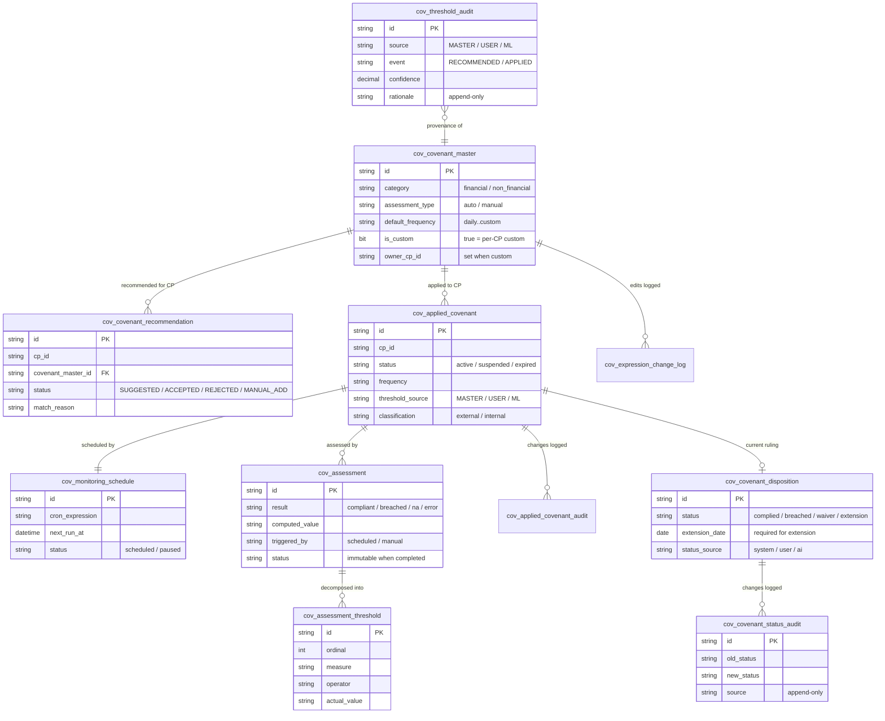
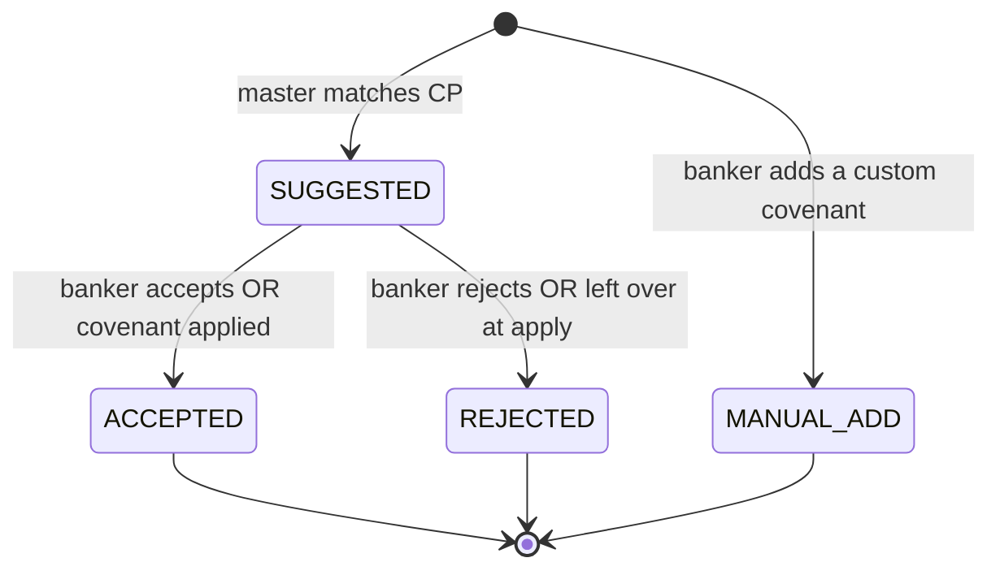
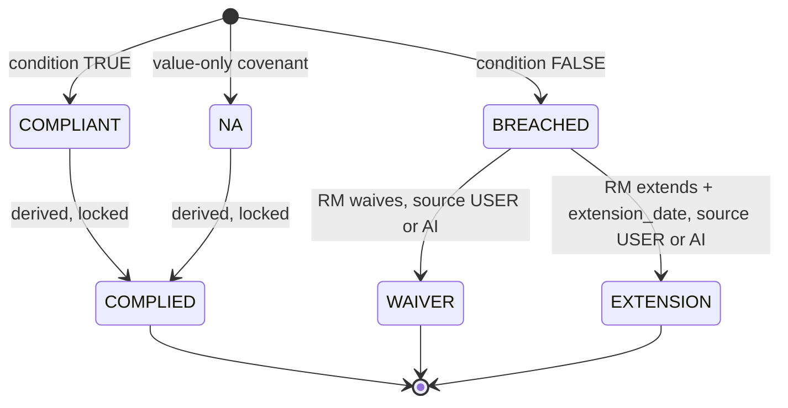
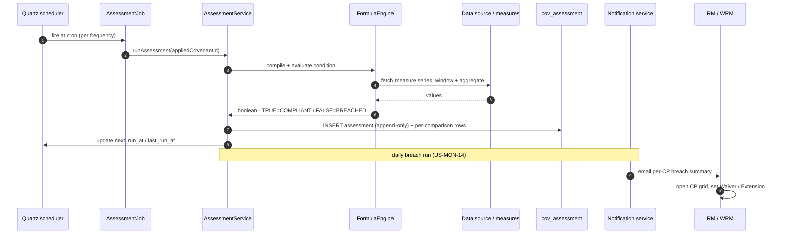

# Covenant Monitoring — End-to-End Journey Playbook

> **Audience:** senior management. **Purpose:** show the *user journey* and, at every step, the
> *exact data-model change* — which table is written and which tag/enum is stamped. Pair this
> playbook with the hero canvas (`covenant-journey.excalidraw`) and the speaker script
> (`covenant-journey-script.md`). Every table, column, enum value, and rule below is verified
> against the current codebase (`entity/`, `enums/`, `db/migration/V1__baseline.sql` + `V3`, and
> the `service/` classes named in each stage).

---

## 0. The story in one line

> A banker **authors** a covenant once, the system **recommends** it to the right deals
> (rules **+** ML), the banker **applies** it, a scheduler **evaluates** it automatically, and a
> relationship manager (RM) **dispositions** any breach — with **every decision written to an
> immutable, append-only audit trail**.

## 1. Cast & vocabulary

| Term | Meaning |
|------|---------|
| **Covenant master** | A reusable covenant *template* in the library (`cov_covenant_master`). |
| **CP** | Credit Proposal — a specific deal we monitor. |
| **Recommendation** | A master matched to a CP, awaiting the banker's decision. |
| **Applied covenant** | A covenant *bound to a CP* with its own frequency & threshold. |
| **Assessment** | One automatic run that computes a value and returns COMPLIANT / BREACHED / NA. |
| **Disposition** | The RM's ruling on a breach: **Waiver** or **Extension**. |
| **Measure** | A named data point (e.g. DSCR) sourced from a data source and used in formulas. |

### Legend of tags used throughout

| Colour | Tag / enum | Where |
|--------|-----------|-------|
| 🔵 Blue | `SUGGESTED` | recommendation just created |
| 🟢 Green | `COMPLIANT` / `COMPLIED` | assessment passed / derived RM status |
| 🔴 Red | `BREACHED` | assessment failed |
| 🟠 Amber | `WAIVER` / `EXTENSION` | RM disposition on a breach |
| ⚪ Grey | `MASTER` | threshold came from the library default |
| 🟣 Purple | `ML` | threshold suggested by the ML model |
| 🟦 Teal | `AI` | disposition suggested by AI and accepted |

---

## 2. The journey at a glance

```mermaid
flowchart LR
    S1["1 - Author master<br/>cov_covenant_master"] --> S2["2 - Recommend for CP<br/>cov_covenant_recommendation"]
    S2 --> S3["3 - Tag / adjust / add custom<br/>ACCEPTED / REJECTED / MANUAL_ADD"]
    S3 --> S4["4 - Apply to CP<br/>cov_applied_covenant"]
    S4 --> S5["5 - Schedule AUTO<br/>cov_monitoring_schedule + QRTZ"]
    S5 --> S6["6 - Evaluate AUTO<br/>cov_assessment"]
    S6 --> D{"Result?"}
    D -->|"COMPLIANT / NA"| C["Complied - locked, read-only"]
    D -->|"BREACHED"| M["7 - Monitor at CP level<br/>read-only, status derived"]
    M --> S8["8 - Disposition<br/>WAIVER / EXTENSION<br/>cov_covenant_disposition"]

    classDef auto fill:#e9ecef,stroke:#868e96,color:#212529;
    classDef breach fill:#ffc9c9,stroke:#e03131,color:#212529;
    classDef ok fill:#b2f2bb,stroke:#2f9e44,color:#212529;
    class S5,S6 auto;
    class M,S8 breach;
    class C ok;
```

Stages **5** and **6** are shaded because they are **automatic** — the system does them, not a user.

---

## 3. Stage-by-stage: user action → data change

Each stage lists **what the user does**, **the screen/service**, and a **data-delta table**
(`Table` · `Operation` · `Key columns / tag stamped`).

### Stage 1 — Author a covenant master
*Screen:* **Covenant Library → New / Edit** · *Service:* `CovenantMasterService`

The author enters: name, `category` (FINANCIAL / NON_FINANCIAL), description, the **condition
formula** (measure-based DSL — validated when `assessment_type = AUTO`), `assessment_type`
(AUTO / MANUAL), `default_frequency` (+ `default_cron` when CUSTOM), and the **eligibility**
(business segments, industries, countries of risk / incorporation, credit-proposal types, legal-entity
types, facility types, collateral types, and the Islamic-banking flag).

| Table | Op | Key columns / tag |
|-------|----|-------------------|
| `cov_covenant_master` | **INSERT** | `is_custom = false`, `owner_cp_id = null`, `active = true`, `category`, `assessment_type`, `default_frequency`, `condition_expression`, `referenced_measures`, 8 eligibility columns |
| `cov_expression_change_log` | INSERT *(on later edit)* | `old_expression → new_expression`, `changed_by`, `changed_date` |

> **So what:** the library is authored **once, centrally**. Formula validation up front means a
> covenant can't be saved in a broken state.

### Stage 2 — Recommend for a selected CP (rules **+** ML)
*Screen:* **Open CP → Recommendations** · *Services:* `RecommendationService` + `MlThresholdService`

The system compares **every active library master's eligibility** to the CP's attributes:

- **Islamic banking** must match **exactly** (`cm.isIslamicBanking() == cp.islamicBanking()`).
- The **other 8 dimensions are AND-combined** — each must match for the master to qualify.
- An **empty list or the sentinel `"ALL"` is a wildcard** (that dimension always matches).
- The reason string is stored, e.g. `"Islamic Banking: Yes; Segment: Commercial; Industry: Technology"`.

In parallel, the resilient **ML client** is asked for per-CP threshold suggestions. It receives
**only CP attributes — never the covenant list** (isolation), and returns
`{covenantMasterId, recommendedExpression, confidence, rationale}`.

| Table | Op | Key columns / tag |
|-------|----|-------------------|
| `cov_covenant_recommendation` | **UPSERT** | `status = SUGGESTED` 🔵, `match_reason`, unique per `(cp_id, covenant_master_id)` |
| `cov_threshold_audit` | INSERT *(per ML suggestion)* | `event = RECOMMENDED`, `source = ML` 🟣, `confidence`, `rationale`, `new_expression` — **logged even if later declined** |

> **So what:** recommendations combine **governed rules** (auditable, deterministic) with **ML
> intelligence** (a suggested number + a confidence + a reason). If the ML service is down, the flow
> continues on rules alone — see §7.

### Stage 3 — Tag / adjust / add custom
*Screen:* **Recommendations grid** · *Services:* `RecommendationService`, `CovenantMasterService`

The banker **accepts** or **rejects** each suggested row, optionally **modifies a threshold**, and can
**add a custom covenant** that exists only for this CP.

| Table | Op | Key columns / tag |
|-------|----|-------------------|
| `cov_covenant_recommendation` | **UPDATE** | `status → ACCEPTED` or `REJECTED` |
| `cov_covenant_master` | INSERT *(custom)* | `is_custom = true`, `owner_cp_id = <CP>`, `assessment_type = MANUAL`, eligibility copied from the CP |
| `cov_covenant_recommendation` | INSERT *(custom)* | `status = MANUAL_ADD`, `match_reason = "Custom covenant"` |

> **So what:** the tag on every row tells you **its provenance and the human decision** —
> suggested vs accepted vs rejected vs manually added. Nothing is silently dropped.

### Stage 4 — Apply covenants to the CP
*Screen:* **Apply grid** · *Service:* `AppliedCovenantService.applyOne()`

The banker bulk-applies the chosen covenants, setting **per-CP** frequency/cron, `start_date`, an
optional **condition override**, `condition_type` (PRECEDENT / SUBSEQUENT) and `classification`
(EXTERNAL / INTERNAL).

| Table | Op | Key columns / tag |
|-------|----|-------------------|
| `cov_applied_covenant` | **INSERT** | `status = ACTIVE`, `frequency`, `condition_type`, `classification`, `threshold_source` = **MASTER** ⚪ if no override, else **USER** / **ML** 🟣 |
| `cov_covenant_recommendation` | UPDATE *(reconcile)* | applied → `ACCEPTED`; any leftover `SUGGESTED` → `REJECTED` |
| `cov_threshold_audit` | INSERT *(if override)* | `event = APPLIED`, `source` = USER / ML, `old → new_expression` |
| `cov_applied_covenant_audit` | INSERT *(on later edit)* | `change_type` ∈ {FREQUENCY, CRON, STATUS}, `old_value → new_value` |

> **So what:** `threshold_source` answers the governance question **"where did this number come
> from?"** — the library, a person, or the model — for every single applied covenant.

### Stage 5 — Schedule *(automatic, on apply)*
*Trigger:* apply → Quartz · *No user action*

| Table | Op | Key columns / tag |
|-------|----|-------------------|
| `cov_monitoring_schedule` | **INSERT** | `cron_expression`, `next_run_at`, `status = SCHEDULED`, `quartz_job_key` |
| `QRTZ_JOB_DETAILS` / `QRTZ_TRIGGERS` / `QRTZ_CRON_TRIGGERS` | INSERT | Quartz job + cron trigger for `assessment-<appliedId>` |

### Stage 6 — Scheduler fires → evaluate the expression *(automatic)*
*Trigger:* Quartz cron · *Services:* `AssessmentJob` → `AssessmentService.runAssessment()` → `FormulaEngine`

At the covenant's frequency, Quartz fires the job. The formula engine fetches each referenced
measure's time-series from the data source, **windows and aggregates** it, substitutes the values, and
evaluates the boolean condition: **TRUE ⇒ COMPLIANT, FALSE ⇒ BREACHED**. Value-only covenants record
**NA**. **MANUAL** covenants create a `PENDING_MANUAL` row for an analyst instead of auto-evaluating.

| Table | Op | Key columns / tag |
|-------|----|-------------------|
| `cov_assessment` | **INSERT (append-only)** | `result` = COMPLIANT 🟢 / BREACHED 🔴 / NA / ERROR; `computed_value`, `evaluated_expression`, `data_snapshot_json`; `triggered_by = SCHEDULED`; `status` pending→in_progress→completed |
| `cov_assessment_threshold` | INSERT *(one per comparison)* | `ordinal`, `measure`, `operator`, `threshold_value`, `actual_value`, `value_type` |
| `cov_monitoring_schedule` | UPDATE | `last_run_at`, `next_run_at` |
| `cov_notification_audit` | INSERT *(daily breach run)* | `run_id`, `email_to/cc`, `cp_ids`, `outcome` — RM/WRM get a per-CP breach summary |

> **So what:** the assessment row is a **permanent, point-in-time snapshot** of the data, the
> expression, and the verdict. It is never edited (US-036) — re-runs create *new* rows.

### Stage 7 — Monitor at CP level *(read-only)*
*Screen:* **Monitoring workspace → open CP → assessment grid** · *Service:* `MonitoringService`

The RM lands from the breach email, toggles **By-CP / By-Covenant**, opens the CP, and reviews the
grid: expression, actual value, headroom, status, timing. The RM-facing status is **derived**
(BREACHED ⇒ *Breached*; COMPLIANT / NA ⇒ *Complied*).

| Table | Op | Key columns / tag |
|-------|----|-------------------|
| *(none)* | **READ-only** | status derived from the latest `cov_assessment.result` — **no DB writes** |

### Stage 8 — Disposition: Waiver / Extension
*Screen:* **Assessment grid → Disposition modal** (+ optional **AI Suggestion** modal) · *Service:* `ReviewService.setDisposition()`

On a **BREACHED** row the RM records **Waiver** or **Extension** (Extension **requires** an
`extension_date`) plus a note. Optionally the RM pulls **AI suggestions** and applies one.

| Table | Op | Key columns / tag |
|-------|----|-------------------|
| `cov_covenant_disposition` | **UPSERT** *(one per `cp_id` + covenant)* | `status = WAIVER / EXTENSION` 🟠, `extension_date`, `status_source = USER` (or **AI** 🟦 when an AI suggestion is applied), `note`, `assessment_id` = the breach |
| `cov_covenant_status_audit` | **INSERT (append-only)** | `old_status → new_status`, `old/new_extension_date`, `source`, `rationale`, `changed_by`, `changed_date` |
| `cov_assessment` | **UNTOUCHED** | disposition is an *overlay*; assessment counts on the dashboard do not change |

> **So what:** a breach is never "erased." The assessment stays red forever; the **disposition** sits
> on top of it, and **who waived what, when, and why** is captured append-only.

---

## 4. The data model (ER)

---

## 5. Lifecycles

### 5a. Recommendation lifecycle

### 5b. Compliance & disposition lifecycle

---

## 6. Under the hood: scheduler → assessment → RM

---

## 7. Governance & controls (the management "so what")

| Control | How it's enforced | Table(s) |
|--------|--------------------|----------|
| **Immutable assessments** | Completed assessments cannot be edited; a re-run inserts a new row (US-036, `rejectIfImmutableFieldChanging()`). | `cov_assessment` |
| **Threshold provenance** | Every applied threshold is tagged MASTER / USER / ML, and every recommend/apply event is written append-only. | `cov_applied_covenant.threshold_source`, `cov_threshold_audit` |
| **Disposition trail** | Every Waiver/Extension change records old→new status, extension date, source, and who/when — append-only. | `cov_covenant_status_audit` |
| **Breach is never erased** | Dispositions overlay the breach; the red assessment and dashboard counts are unchanged. | `cov_assessment` (untouched) |
| **ML isolation** | The ML request carries only CP attributes, never the covenant list. | — |
| **ML resilience** | Circuit breaker + retry + time limiter; on any failure the call returns an empty list and the rules-based flow continues. | `WebClientMlThresholdRecommender` |
| **Notification audit** | Every outbound breach-email attempt is logged with outcome. | `cov_notification_audit` |

---

## Appendix — enum tag reference (verified)

| Enum | Values | Table.column |
|------|--------|--------------|
| `RecommendationStatus` | SUGGESTED, ACCEPTED, REJECTED, MANUAL_ADD | `cov_covenant_recommendation.status` |
| `ThresholdSource` | MASTER, USER, ML | `cov_applied_covenant.threshold_source`, `cov_threshold_audit.source` |
| ThresholdAudit event | RECOMMENDED, APPLIED | `cov_threshold_audit.event` |
| `AssessmentResult` | COMPLIANT, BREACHED, NA, ERROR, PENDING_REVIEW | `cov_assessment.result` |
| `AssessmentStatus` | pending, in_progress, completed, pending_manual | `cov_assessment.status` |
| `AssessmentType` | AUTO, MANUAL | `cov_covenant_master.assessment_type` |
| `CovenantCategory` | FINANCIAL, NON_FINANCIAL | `cov_covenant_master.category` |
| `AppliedCovenantStatus` | ACTIVE, SUSPENDED, EXPIRED | `cov_applied_covenant.status` |
| `CovenantConditionType` | PRECEDENT, SUBSEQUENT | `cov_applied_covenant.condition_type` |
| `CovenantClassification` | EXTERNAL, INTERNAL | `cov_applied_covenant.classification` |
| `Frequency` | DAILY, WEEKLY, MONTHLY, QUARTERLY, YEARLY, CUSTOM | `cov_applied_covenant.frequency` |
| `ScheduleStatus` | SCHEDULED, PAUSED | `cov_monitoring_schedule.status` |
| `CovenantDispositionStatus` | COMPLIED, BREACHED, WAIVER, EXTENSION | `cov_covenant_disposition.status` |
| `CovenantStatusSource` | SYSTEM, USER, AI | `cov_covenant_disposition.status_source` |

> Enum values persist **lowercase** in the database (CHECK-constrained); shown uppercase here to
> match the Java enum names and for readability on screen.
