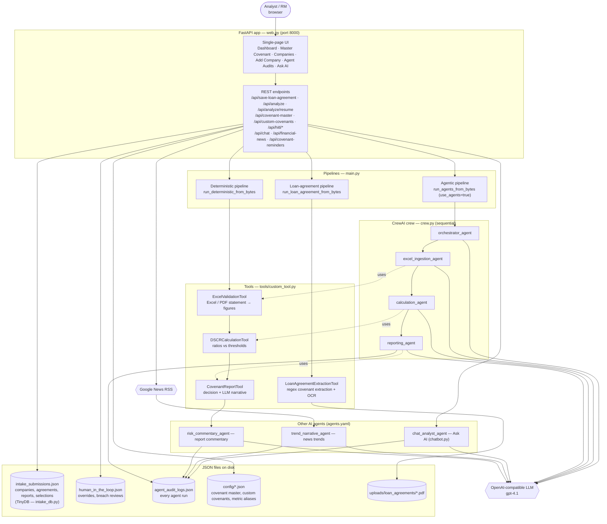
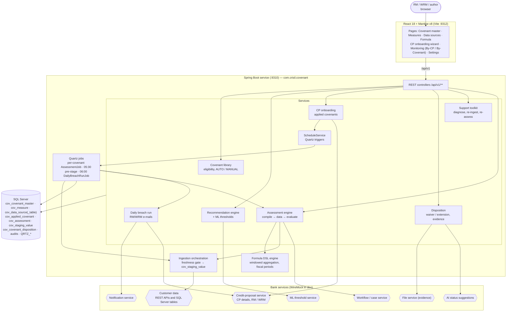
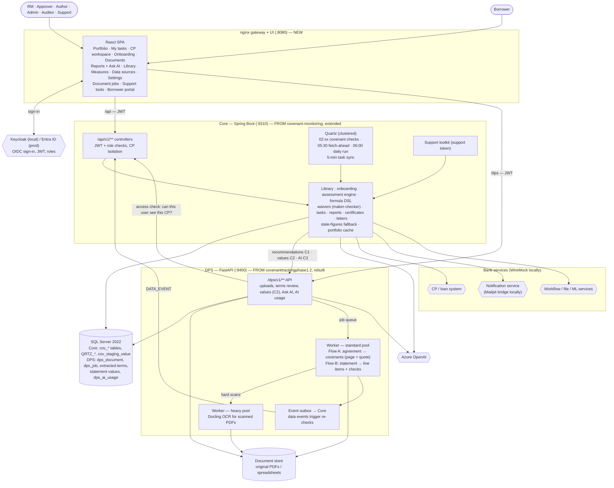

# Architecture of the three covenant systems

Covenexa (`covenant-platform`) was built on top of two earlier applications. This page shows the
architecture of each one and how they were combined.

| # | System | Built by | Where it lives |
|---|---|---|---|
| 1 | **covenanttrackingphase1.2** — "Covenant automatic tracking" | Our team | `C:\Users\vishw\OneDrive\Desktop\covenanttrackingphase1.2` |
| 2 | **covenant-monitoring** — "Covenant Monitoring System" | The second team | `C:\Users\vishw\OneDrive\Desktop\covenant-monitoring` |
| 3 | **covenant-platform** — Covenexa, the combined product | Built on 1 + 2 | `C:\Users\vishw\covenant-platform` (GitHub `Vishwas2311/loan-covenant-platform`) |

---

## 1. covenanttrackingphase1.2 (our original app)

**In one line:** a single Python web app that reads a loan agreement and a financial statement, works
out the covenant ratios for one company, and writes an AI-assisted report.

### Stack

| Layer | Technology |
|---|---|
| Language | Python 3.12 |
| Web server + UI | FastAPI 0.136 + Uvicorn; the whole UI (HTML, CSS, JS) is generated inside `web.py` (10,305 lines) |
| AI agents | CrewAI 1.13, 7 agents, model `openai/gpt-4.1` through an OpenAI-compatible API (`.env`) |
| Documents | pypdf (text PDFs), pypdfium2 + RapidOCR (scanned PDFs), openpyxl + pandas (Excel) |
| Storage | No database server: TinyDB / JSON files on disk |
| External | Google News RSS (company news) |
| Run | `python -c "from covenanttrackingphase1.web import serve; serve()"` on port 8000 |

### Diagram

**How a company is processed:** Add Company → upload the loan agreement (covenants pulled out with
regular expressions, OCR for scans) → choose covenants in "Covenant Master Configuration" → upload a
financial statement per cycle → ratios calculated (deterministic, or by the CrewAI crew) → missing
inputs asked from the user (human in the loop) → report with an AI narrative.

**Limits that drove the combination:** one process, JSON files instead of a database, no sign-in or
roles, no scheduler or e-mail (reminders are only computed when the page asks), one company at a time.

---

## 2. covenant-monitoring (the second team's app)

**In one line:** a bank-grade Java service that keeps a covenant library, applies covenants to credit
proposals (CPs), checks them on a schedule against the bank's data, and runs the breach workflow.

### Stack

| Layer | Technology |
|---|---|
| Backend | Java 17, Spring Boot 3.3, Spring Data JPA (Hibernate, `ddl-auto: validate`), Spring WebClient |
| Scheduling | Quartz (JDBC job store, `QRTZ_*` tables) |
| Database | SQL Server in production; H2 in `MODE=MSSQLServer` for dev and tests; Flyway migrations; every table `cov_*` |
| Formula engine | Own DSL: lexer, parser, type checker, evaluator, renderer (`formula/`) |
| Resilience | resilience4j circuit breakers and retries on every external call |
| Frontend | React 18, Mantine v8, TanStack Query, Vite (port 9312, proxy to 9310) |
| Dev stubs | WireMock for every bank service |
| Quality gates | JaCoCo 95% line / 90% branch, SpotBugs + FindSecBugs, OWASP dependency-check, ESLint, Vitest |
| Run | `start.bat`, or `mvn spring-boot:run` on port 9310 |

### Diagram

**What it lacked for us:** it could not read documents. Every threshold and every figure had to come from
the bank's systems or be typed in; there was no extraction from loan agreements or statements, and no
AI reading of documents.

---

## 3. covenant-platform — Covenexa (what we built on top of both)

**In one line:** the second team's service became **Core** (the system of record that decides
compliance), our Python code became **DPS** (the Document Processing Service), and a new UI, real
sign-in and production packaging were built around them.

### Stack

| Layer | Technology | Came from |
|---|---|---|
| UI | React 18, Mantine, TanStack Query, Vite; served by nginx, which is also the gateway (`:8080`) | New (ideas from both) |
| Sign-in | OpenID Connect: Keycloak locally, Microsoft Entra ID in production; JWT on every call; roles RM, APPROVER, AUTHOR, ADMIN, AUDITOR, SUPPORT, BORROWER | New |
| Core | Java 17, Spring Boot 3.5, JPA, Quartz (clustered in prod), formula DSL, Flyway (V1…V32) | covenant-monitoring, extended |
| DPS | Python 3.12, FastAPI, CrewAI Flows, SQLAlchemy + Alembic, pypdf, RapidOCR, Docling (heavy pool), openpyxl, xlrd | covenanttrackingphase1.2, rebuilt |
| AI | Azure OpenAI (Ask AI, agreement Q&A, narratives, AI suggestions); token use recorded per call | Both, consolidated |
| Database | SQL Server 2022: Core's `covenant` DB and DPS's tables, `READ_COMMITTED_SNAPSHOT` | covenant-monitoring |
| Deploy | Docker Compose locally (`deploy/`); Core and DPS images; optional Mailpit and two-node files | New |
| CI | GitHub Actions: build, tests, coverage, SpotBugs, golden-set gate, bandit, semgrep, pip-audit, npm audit, Trivy | New |

### Diagram

### What came from where

| Capability | From covenanttrackingphase1.2 | From covenant-monitoring | New in covenant-platform |
|---|---|---|---|
| Reading loan agreements | Regex extraction, OCR | — | CrewAI Flow A, citation check, review screen, amendments (C7), security covenants |
| Reading statements | Excel/PDF reading, ratio formulas, metric aliases | — | Flow B, cell references, data-quality checks, `.xls`, corrections, Values API (C2) |
| Covenant library and formula | Master covenant list, custom formulas | Library, eligibility, DSL, measures, data sources | Rules from agreements feed onboarding |
| Checking covenants | One run per upload | Quartz schedules, assessment engine, staging | Stale-figures fallback, clustered scheduler, re-check on new data |
| Breach workflow | Human review of breaches | Waiver / extension, evidence, AI suggestions | Maker-checker approval, tasks, alerts, letters, escalation digest |
| AI | 7 CrewAI agents on gpt-4.1 | AI status-suggestion client | Azure OpenAI, Ask AI scoped to the user's CPs, agreement Q&A, token tracking |
| Users and security | None | Header-based user (dev) | OIDC sign-in, 7 roles, CP isolation in Core and DPS, support token |
| Borrowers | — | — | Borrower portal, reminders, certificates |
| Storage | JSON files | SQL Server / H2 | SQL Server for both services, document store |
| Operations | Manual start | Support toolkit | Docker images, runbook, CI security gates, load-tested on one and two Core nodes |

More detail: [`docs/integration/01-current-state.md`](../integration/01-current-state.md) (both original
apps), [`docs/integration/02-target-architecture.md`](../integration/02-target-architecture.md) (the
design), and [`docs/user-guide.md`](../user-guide.md) (every feature).
