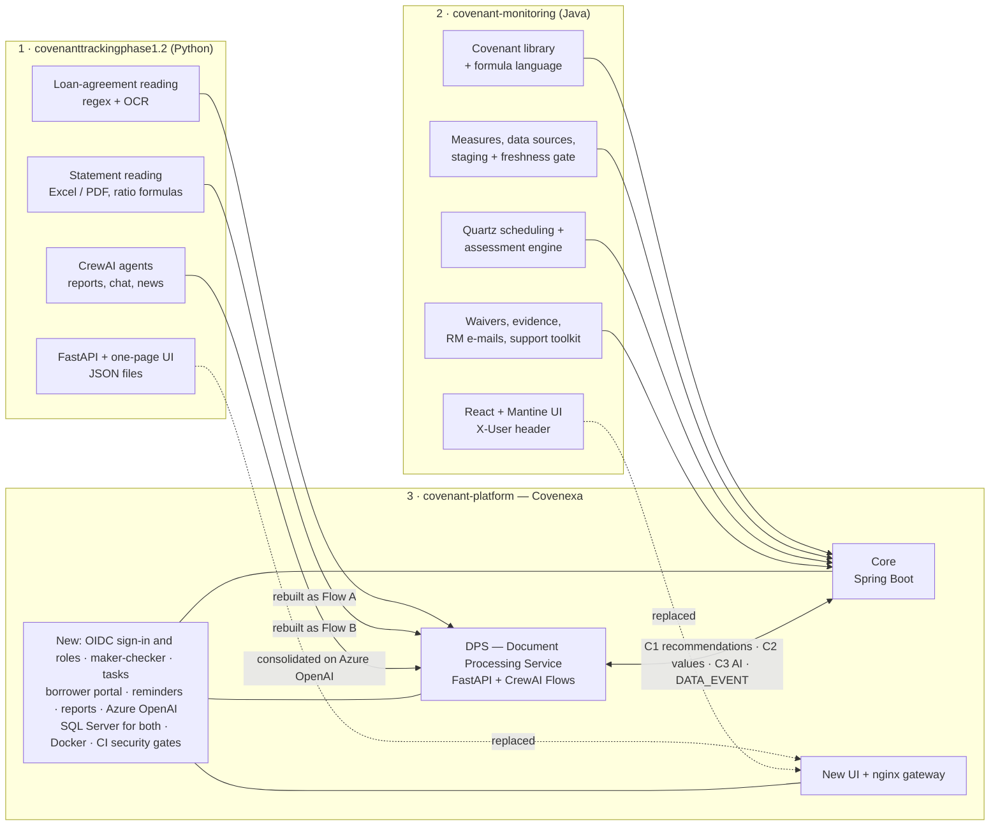

# Architecture of the three covenant systems

Covenexa (`covenant-platform`) was built on top of two earlier applications. Each has its own page
with its stack, component diagram, main journeys, data model and API map.

| # | System | Built by | Page | Where the code lives |
|---|---|---|---|---|
| 1 | **covenanttrackingphase1.2** — "Covenant automatic tracking" | Our team | [covenanttrackingphase1.2.md](covenanttrackingphase1.2.md) | `C:\Users\vishw\OneDrive\Desktop\covenanttrackingphase1.2` |
| 2 | **covenant-monitoring** — "Covenant Monitoring System" | The second team | [covenant-monitoring.md](covenant-monitoring.md) | `C:\Users\vishw\OneDrive\Desktop\covenant-monitoring` |
| 3 | **covenant-platform** — Covenexa, the combined product | Built on 1 + 2 | [covenant-platform.md](covenant-platform.md) | `C:\Users\vishw\covenant-platform` (GitHub `Vishwas2311/loan-covenant-platform`) |

## How the three relate

## Side by side

| | covenanttrackingphase1.2 | covenant-monitoring | covenant-platform |
|---|---|---|---|
| Purpose | Read one company's documents and report its covenant ratios | Monitor covenants for every CP from the bank's data | Both, end to end, for the whole bank |
| Language | Python 3.12 | Java 17 + TypeScript | Java 17 + Python 3.12 + TypeScript |
| Backend | FastAPI, one process | Spring Boot 3.5 | Core (Spring Boot 3.5) + DPS (FastAPI) + DPS workers |
| UI | HTML inside `web.py` | React 18 + Mantine 8 | React 18 + Mantine, behind nginx |
| AI | CrewAI agents, gpt-4.1 | AI suggestion client | CrewAI Flows, Azure OpenAI |
| Documents | Regex + OCR | None | Flow A / Flow B, Docling for scans, human review |
| Data store | JSON files (TinyDB) | H2 / SQL Server | SQL Server + document store |
| Scheduling | None | Quartz, single node | Quartz, clustered |
| Sign-in | None | `X-User` header | Keycloak / Entra ID, 7 roles |
| E-mail | None | RM summary e-mail | Summaries, escalation digest, borrower reminders, saved reports |
| Packaging | Run from a terminal | `start.bat` | Docker images, Compose, runbook |
| Quality gates | None | Coverage, SpotBugs, OWASP | Coverage, SpotBugs, golden set, bandit, semgrep, pip-audit, npm audit, Trivy |

More detail: [`docs/integration/01-current-state.md`](../integration/01-current-state.md) (both original
apps as found on 2 November), [`docs/integration/02-target-architecture.md`](../integration/02-target-architecture.md)
(the design), and [`docs/user-guide.md`](../user-guide.md) (every feature).
