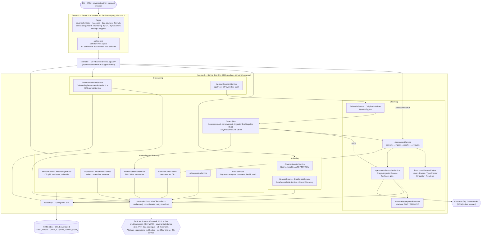
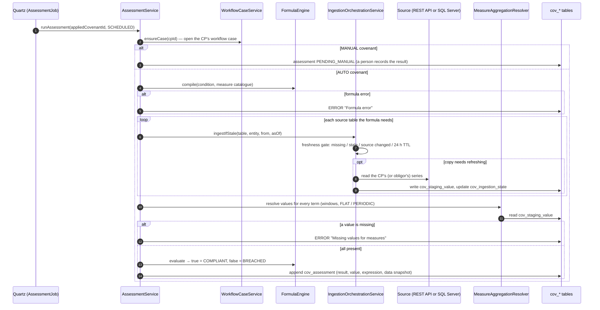
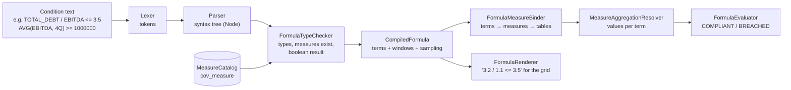
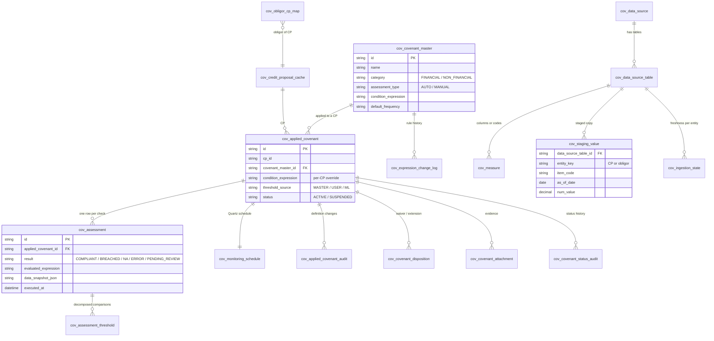

# covenant-monitoring — "Covenant Monitoring System" (the second team's app)

| | |
|---|---|
| Built by | The second team |
| Location | The folder `covenant-monitoring`, kept outside this repository, on the development laptop where the integration was done (a plain folder, not a git repository; copy it separately if you need it) |
| Read from | `README.md`, `CLAUDE.md`, `backend/pom.xml`, `backend/src/main/resources/application*.yml`, `db/migration`, `wiremock/mappings`, the Java packages under `com.crisil.covenant`, `frontend/package.json`, `frontend/vite.config.ts`, `frontend/src/pages` |
| In one line | A bank-grade Java service that keeps a covenant library, applies covenants to credit proposals (CPs), checks them on a schedule against the bank's own data, and runs the breach workflow |

Back to the [overview](README.md).

## 1. Technology stack

| Layer | Technology | Where |
|---|---|---|
| Backend language | Java 17 | `backend/pom.xml` |
| Framework | Spring Boot 3.5.14: Web (MVC), Data JPA (Hibernate, `ddl-auto: validate`), Validation, Actuator, WebFlux (for WebClient only) | `backend/pom.xml` |
| Scheduling | Quartz, JDBC job store (`QRTZ_*` tables), not clustered (`isClustered: false`) | `application.yml` |
| Database | H2 file database in `MODE=MSSQLServer` for local runs and tests; SQL Server in production (mssql-jdbc 12.8.1) | `application*.yml`, `pom.xml` |
| Migrations | Flyway: production `V1`–`V12`, dev demo data `V10`–`V24`; every application table named `cov_*` | `db/migration`, `db/demo` |
| Formula language | Own engine: Lexer → Parser → TypeChecker → Evaluator → Renderer, with windowed aggregation and fiscal periods | `formula/` |
| External calls | Spring WebClient + resilience4j (circuit breaker, retry, time limit) | `service/impl/WebClient*`, `application.yml` |
| API docs | springdoc-openapi (`/swagger-ui.html`) | `pom.xml`, `application.yml` |
| Dev stubs | WireMock on port 9311 for every bank service; an in-app mock ML endpoint in the dev profile | `wiremock/mappings`, `application-dev.yml` |
| User identity | No Spring Security: the user is the `X-User` request header (a dev user switcher in the UI); the support API needs an `X-Support-Token` | `config/CurrentUserContext.java`, `config/SupportTokenInterceptor.java` |
| Frontend | React 18, Mantine 8, TanStack Query 5, Vite 5 (dev server 9312, proxy `/api` → 9310) | `frontend/package.json`, `vite.config.ts` |
| Quality gates | JaCoCo 95% line / 90% branch, SpotBugs + FindSecBugs, OWASP dependency-check (CVSS 7), ESLint (0 warnings), Vitest, Playwright | `CLAUDE.md`, `pom.xml` |
| Run | `start.bat`; or `mvn spring-boot:run` (port 9310) and `npm run dev` (port 9312) | `README.md` |

## 2. Component architecture

## 3. Scheduled covenant check (one covenant)

## 4. Daily timetable

```mermaid
gantt
    title What runs by itself (server time)
    dateFormat HH:mm
    axisFormat %H:%M
    section Per covenant
    Each covenant's own AssessmentJob (default crons, all at 2 am) :a1, 02:00, 30m
    section Portfolio
    IngestionPreStageJob — copy figures for covenants due soon :a2, 05:30, 20m
    DailyBreachRunJob — assess due covenants, e-mail RM cc WRM :a3, 06:00, 30m
```

In this original version every covenant of a frequency used the same default cron, so thousands of
checks started in the same second at 02:00 (fixed later in covenant-platform, BUG-08).

## 5. The formula language engine

## 6. Data model (main tables)

Other tables: `cov_covenant_recommendation`, `cov_threshold_audit`, `cov_compliance_certificate`,
`cov_notification_audit`, `cov_ops_audit`, `cov_reporting_setting` (23 `cov_*` tables in all).

## 7. REST API map (`/api/v1`)

| Area | Endpoints |
|---|---|
| Covenant library | `/covenants` (CRUD, `/{id}/audit`, `/{id}/usage`) |
| Measures and sources | `/measures`, `/data-sources` (`/{id}/test`, `/{id}/columns`), `/data-sources/{id}/tables` (`/columns`, `/code-values`) |
| Formula | `/formulas/validate`, `/formulas/metadata`, `/formulas/thresholds`, `/formulas/apply-thresholds`, `/schedules/validate-cron` |
| Onboarding | `/credit-proposals/{cpId}` (`/recommendations`, `/onboarding-recommendations`, `/custom-covenants`, `/applied-covenants`, `/ml-threshold-recommendations`) |
| Applied covenants | `/applied-covenants/{id}` (PATCH, `/audit`, `/definition-history`) |
| Assessments | `/assessments/run`, `/assessments`, `/assessments/{id}`, `/{id}/complete-manual` |
| Monitoring | `/monitoring/summary`, `/schedule`, `/cps/{cpId}/covenants`, `/cp/{cpId}/review`, status, status-audit, attachments, cycles, `/notification-runs` |
| Settings | `/settings/reporting` |
| Support (`X-Support-Token`) | `/ops/cps/{cpId}/diagnostics`, `/staging`, `/ingestion-state`, `/reingest`, `/data`; `/ops/applied-covenants/{id}/reassess`; `/ops/health/data-sources`; `/ops/audit` |

## 8. What it did well, and what it lacked

| Did well | Lacked for our purpose |
|---|---|
| Real database, migrations, append-only audit everywhere | Could not read documents: every threshold and figure came from bank systems or was typed in |
| Covenant library, eligibility rules, formula language with windows and fiscal periods | No AI reading of agreements or statements |
| Quartz scheduling, staging with a freshness gate, support toolkit | No real sign-in: the user was a request header |
| Strict quality gates (95% coverage, SpotBugs, OWASP) | Scheduler not clustered; all default checks fired in one second |

This service became **Core** in covenant-platform; see [covenant-platform.md](covenant-platform.md).
