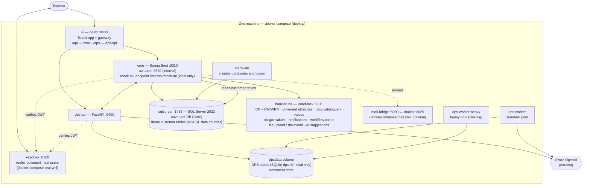
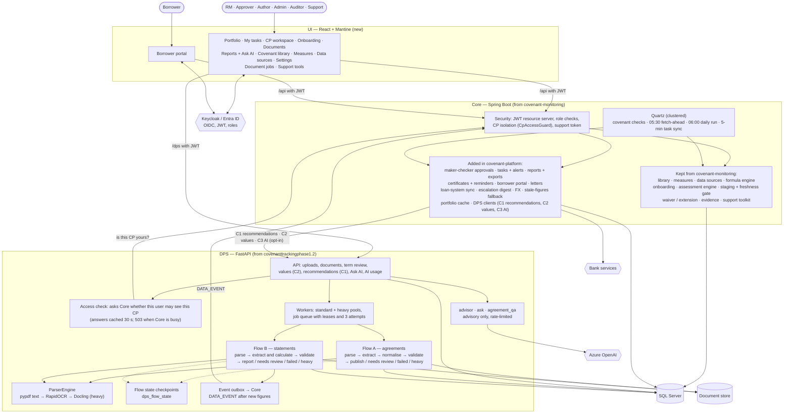
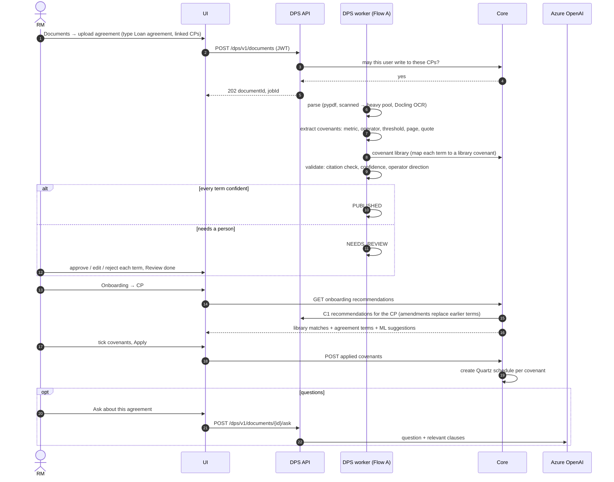
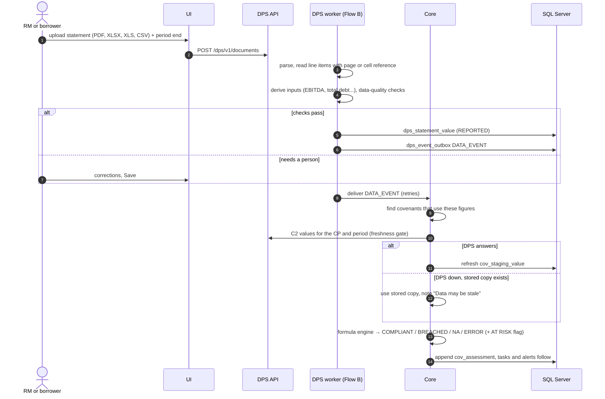
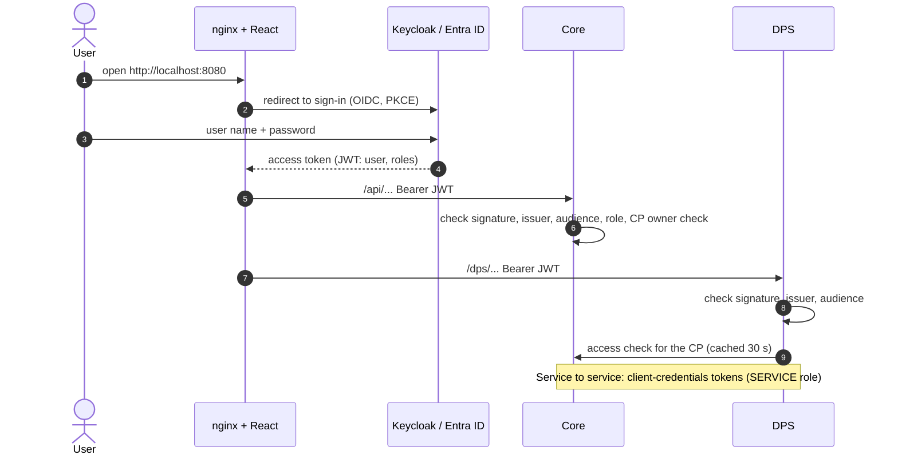
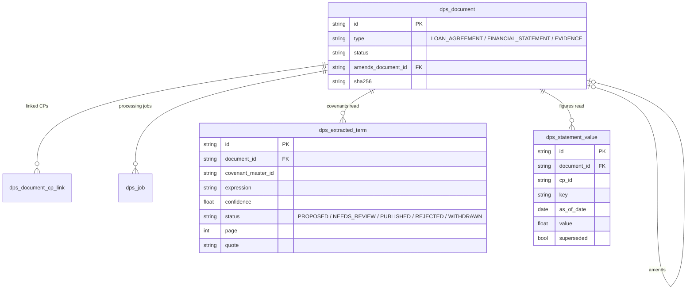
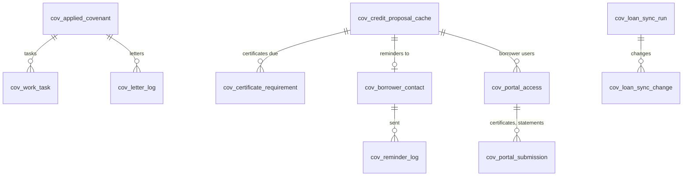
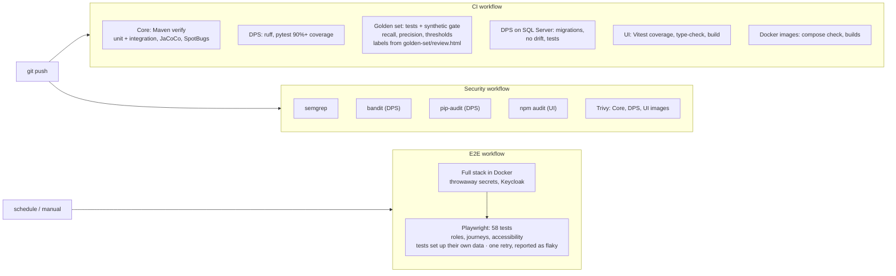

# covenant-platform — Covenexa (the product built on both apps)

| | |
|---|---|
| Built by | Our team, on top of [covenanttrackingphase1.2](covenanttrackingphase1.2.md) and [covenant-monitoring](covenant-monitoring.md) |
| Location | This repository, GitHub `Vishwas2311/loan-covenant-platform` (clone it anywhere) |
| Folders | `core/` (Java service), `dps/` (Python service), `ui/` (React app), `deploy/` (Docker Compose files, Keycloak realm, stack-init, mail bridge, smoke test), `contracts/` (OpenAPI contracts, Redocly lint), `golden-set/` (extraction test set, review tool), `loadtest/`, `scripts/` (line-ending fixer, demo-data reset), `.github/workflows/` (CI, Security, E2E), `docs/`, `outputs/` (readiness review), `graphify-out/` (code knowledge graph) |
| In one line | covenant-monitoring became **Core**, the system of record that decides compliance; covenanttrackingphase1.2 became the **Document Processing Service (DPS)**, which reads agreements and statements; a new UI, real sign-in, borrower portal and production packaging were built around them |

Back to the [overview](README.md). What each page does for a user: [user-guide.md](../user-guide.md).

## 0. The whole system in one diagram

Every part, its technology stack, and how it connects, top to bottom: users, gateway and sign-in, UI pages, Core (request pipeline, scheduler, the 06:00 daily run, business areas, the assessment engine, bank clients), DPS (request checks, endpoints, Flow A and Flow B step by step, event outbox), the data, each bank service, the AI provider, and how it is built and run. The diagram is wide: on GitHub use its zoom and pan buttons. The numbered labels on the arrows are the steps in the table below it. Sections 2–9 zoom into each part.

```mermaid
%%{init: {"flowchart": {"wrappingWidth": 340, "nodeSpacing": 20, "rankSpacing": 55}}}%%
flowchart TB
    subgraph L1["1 · USERS"]
        direction LR
        staff(["Bank staff<br/>RM · Approver · Author<br/>Admin · Auditor · Support"])
        borrower(["Borrower<br/>(shared CPs only)"])
    end

    subgraph L2["2 · EDGE AND SIGN‑IN"]
        direction LR
        gw["Gateway — nginx 1.30 (alpine) · :8080<br/>serves the React build · /api → Core · /dps → DPS<br/>security headers · X-Correlation-Id"]
        idp{{"Identity provider<br/>Keycloak 26.7 (local) · Entra ID (prod)<br/>OIDC code flow + PKCE · JWT with roles"}}
    end

    subgraph L3["3 · UI — React 18.3 · TypeScript 5.9 · Mantine 8.3 · TanStack Query 5 · React Router 7 · Vite 6 · oidc‑client‑ts 3.5"]
        direction TB
        subgraph UP["Pages (one per menu item, shown by role)"]
            direction LR
            pPort["Portfolio<br/>+ due in 30 days"] ~~~ pTask["My tasks"] ~~~ pRep["Reports<br/>+ Ask AI"] ~~~ pCp["CP<br/>workspace"] ~~~ pOnb["Onboarding"] ~~~ pDoc["Documents"] ~~~ pLib["Covenant<br/>library"] ~~~ pMea["Measures"] ~~~ pDs["Data<br/>sources"] ~~~ pSet["Settings"] ~~~ pJob["Document<br/>jobs"] ~~~ pSup["Support<br/>tools"] ~~~ pPortal["Borrower<br/>portal"]
        end
        uiapi["API layer — fetch with the user's Bearer token · typed endpoints and types · light / dark theme"]
        UP --> uiapi
    end

    subgraph L4["4 · CORE — Java 17 · Spring Boot 3.5.16 · Spring Security · JPA / Hibernate · Flyway · Quartz · :9310 — from covenant‑monitoring"]
        direction TB
        csec["Request pipeline — Spring Security JWT resource server<br/>roles · CpAccessGuard (CP isolation) · support token for /ops<br/>request id + user in every log line"]
        subgraph SCH["Quartz scheduler — JDBC store, clustered (IST)"]
            direction LR
            s1["Every 5 min<br/>task sync"]
            s2["02:00–02:59<br/>each covenant's own check"]
            s3["05:30<br/>fetch-ahead (due in 3 days)"]
            s1 ~~~ s2 ~~~ s3
        end
        subgraph DAILY["06:00 daily run — in this order"]
            direction LR
            d1["1 · Loan-system<br/>sync"]
            d2["2 · Check every<br/>due covenant"]
            d3["3 · RM / WRM<br/>summary e-mails"]
            d4["4 · Borrower<br/>reminders"]
            d5["5 · Saved<br/>reports"]
            d6["6 · Escalation<br/>digest"]
            d1 --> d2 --> d3 --> d4 --> d5 --> d6
        end
        subgraph CA["Business areas — 34 REST controllers · 86 services"]
            direction LR
            c1["Library + formula engine<br/>covenants · measures · data sources<br/>switch off · used by N loans · change history<br/>credit-policy link · test connection"]
            c2["Onboarding<br/>library matches · agreement terms<br/>ML thresholds · apply"]
            c4["Monitoring + review<br/>grid · record result · Check now<br/>one loan's rule change · pause / resume<br/>waivers (maker-checker) · withdraw<br/>tasks · alerts · evidence"]
            c6["Reports + e-mail<br/>breach report PDF / Excel<br/>saved reports"]
            c5["Borrower side<br/>certificates (add / delete) · reminders<br/>portal access · letters"]
            c7["Support toolkit<br/>diagnose · reload · re-check<br/>audit log · sent-email history"]
            c1 -->|"rules"| c2
            c2 -->|"A7 apply"| c4
            c4 -->|"breaches"| c6
            c5 -->|"certificates due"| c4
            c7 ~~~ c1
        end
        subgraph AE["Assessment engine — every check (scheduled, Check now, or new figures)"]
            direction LR
            e1["1 · Compile rule<br/>formula DSL"]
            e2["2 · Freshness gate<br/>refresh stored copy if stale"]
            e3["3 · Resolve values<br/>windows · sampling · max age"]
            e4["4 · Evaluate<br/>compare to threshold"]
            e5["5 · Result<br/>COMPLIANT · BREACHED · NA · ERROR<br/>PENDING_REVIEW → a person records it<br/>+ AT RISK flag (headroom below the Settings level)<br/>+ 'data may be stale' note"]
            e1 --> e2 --> e3 --> e4 --> e5
        end
        cclients["Bank-service clients — Spring WebClient · resilience4j 2.2<br/>OAuth client credentials or fixed token · retries + circuit breakers<br/>data sources only to allow-listed hosts (JDBC + REST)"]
        csec --> CA
        SCH -->|"02:00 checks · 05:30 fetch-ahead"| AE
        SCH --> DAILY
        DAILY -->|"step 2"| AE
        CA -->|"Check now · new data · re-check"| AE
        AE -->|"results → tasks, alerts"| CA
        CA --> cclients
        DAILY --> cclients
        AE --> cclients
    end

    subgraph L5["5 · DPS — Python 3.12 · FastAPI 0.136 · Uvicorn · CrewAI Flows 1.15 · SQLAlchemy 2 + Alembic · :9400 — from covenanttrackingphase1.2"]
        direction TB
        dguard["Request checks<br/>JWT (issuer, audience, signature) · CP access via Core, cached 30 s<br/>per-user rate limits on Ask AI, questions and uploads"]
        subgraph DE["Endpoints /dps/v1"]
            direction LR
            dUp["Uploads + documents<br/>PDF · XLSX · XLS · CSV<br/>≤ 50 MB · ≤ 500 pages<br/>link to more CPs · remove (kept for audit)"]
            dRev["Term review + spreads<br/>approve · edit · reject<br/>corrections"]
            dServe["Serving Core<br/>C1 recommendations<br/>C2 values · C3 AI"]
            dAsk["Ask AI + agreement Q&A<br/>advisory only"]
            dJob["Jobs<br/>status · retry · resume"]
            dUp -->|"A4 needs review"| dRev
            dRev -->|"A5 publish"| dServe
            dServe ~~~ dAsk ~~~ dJob
        end
        subgraph FA["Flow A — loan agreements (CrewAI Flow, checkpointed)"]
            direction LR
            a1["A3·1 Parse<br/>ParserEngine: pypdf →<br/>RapidOCR → Docling (heavy)<br/>in-house · no Azure Document Intelligence"]
            a2["A3·2 Extract<br/>metric · operator · threshold<br/>page · quote"]
            a3["A3·3 Normalise<br/>map to Core library (C4)<br/>amounts in crore"]
            a4["A3·4 Validate<br/>citation · confidence ≥ 0.8<br/>operator direction"]
            a5["Outcome<br/>published · needs review<br/>failed · heavy pool"]
            a1 --> a2 --> a3 --> a4 --> a5
        end
        subgraph FB["Flow B — financial statements (CrewAI Flow, checkpointed)"]
            direction LR
            b1["B2·1 Parse<br/>long reports: find statement pages first<br/>PDF tables: pdfplumber word positions<br/>scans, garbled text: RapidOCR boxes<br/>XLSX · XLS · CSV cells"]
            b2["B2·2 Line items<br/>current annual standalone column<br/>skips note, quarter, prior-year columns<br/>units → crore"]
            b3["B2·3 Derive<br/>EBITDA · total debt · ratios"]
            b4["B2·4 Data-quality checks<br/>balance · period · signs<br/>required items · scan read below 97%<br/>optional second reader (AI) disagrees"]
            b5["Outcome<br/>reported · needs review<br/>failed · heavy pool"]
            b1 --> b2 --> b3 --> b4 --> b5
        end
        dout["Event outbox — DATA_EVENT per CP and period<br/>retried until Core accepts it"]
        dguard --> DE
        DE -->|"A2 job queue (dps_job · leases · 3 attempts)"| FA
        DE -->|"B1 job queue"| FB
        FB -->|"B3 figures reported"| dout
        DE -->|"R1 document removed → its figures withdrawn"| dout
    end

    subgraph L6["6 · DATA — SQL Server 2022 (CU15) · READ_COMMITTED_SNAPSHOT on"]
        direction LR
        sqlcore[("Core database<br/>36 cov_* tables · Quartz QRTZ_*<br/>append-only assessments · staging copy · audits<br/>Flyway V1–V32")]
        sqldps[("DPS tables<br/>documents · jobs · extracted terms · statement values<br/>outbox · flow state · AI usage · Alembic")]
        store[("Document store<br/>content-addressed original files")]
    end

    subgraph L7["7 · BANK SERVICES — WireMock 3.9 stand‑ins locally"]
        direction LR
        bCp{{"Credit proposals<br/>CP · RM / WRM · loan status"}}
        bAtt{{"Covenant<br/>attributes"}}
        bData{{"Data API<br/>+ catalogue"}}
        bTab{{"Bank data tables<br/>SQL Server"}}
        bWf{{"Workflow<br/>cases"}}
        bFile{{"File<br/>service"}}
        bNot{{"Notification service<br/>e-mail (Mailpit 1.27 locally)"}}
        bMl{{"ML thresholds<br/>(mock in Core locally)"}}
        bAi{{"AI status<br/>suggestions"}}
    end

    subgraph L8["8 · AI PROVIDER"]
        aoai{{"Azure OpenAI<br/>via CrewAI / LiteLLM<br/>on when DPS_AI_MODEL = azure/‹deployment›<br/>empty → fixed rules, app still works"}}
    end

    subgraph L9["9 · BUILD, RUN AND OPERATE"]
        direction LR
        ci["GitHub Actions<br/>CI: Maven verify · pytest · golden-set gate · UI build<br/>golden-set review page (analyst labelling)<br/>Security: semgrep · bandit · pip-audit · npm audit · Trivy<br/>nightly E2E: Playwright on the full stack"]
        deploy["Docker images + Compose<br/>Core: Temurin 17 JRE · DPS: Python 3.12 slim<br/>UI: nginx alpine · real sign-in · mail · two Core nodes"]
        obs["Operations<br/>actuator + Prometheus :9320 · runbook<br/>support toolkit · load tests"]
        ci ~~~ deploy ~~~ obs
    end

    staff -->|"① HTTPS"| gw
    borrower -->|"① HTTPS"| gw
    gw <-->|"② sign-in (OIDC + PKCE)"| idp
    gw -->|"③ serves the app"| L3
    uiapi -->|"/api + JWT — onboarding, reviews, waivers, reports"| csec
    uiapi -->|"/dps + JWT — A1 agreement / B1 statement uploads, review, Ask AI"| dguard

    csec <-->|"Core → DPS: A6 C1 proposals · B5 C2 figures · C3 AI (opt-in)<br/>DPS → Core: access check · C4 library + measures · B4 C5 DATA_EVENT → re-check"| dguard

    L4 -->|"JDBC (HikariCP)"| sqlcore
    L5 -->|"SQLAlchemy (pymssql)"| sqldps
    L5 -->|"files"| store

    cclients -->|"CP · RM/WRM · loan sync"| bCp
    cclients -->|"eligibility"| bAtt
    cclients -->|"REST values + catalogue"| bData
    cclients -->|"JDBC values"| bTab
    cclients -->|"one case per CP"| bWf
    cclients -->|"evidence · certificates"| bFile
    cclients -->|"summaries · reminders · reports · escalation"| bNot
    cclients -->|"suggested thresholds"| bMl
    cclients -->|"C3 default"| bAi

    DE -->|"Ask AI · Q&A · narratives · C3"| aoai

    aoai ~~~ L9
    %% one vertical stack of layers
    cclients ~~~ dguard
    FA ~~~ FB
    dout ~~~ sqlcore
    dout ~~~ sqldps
    sqldps ~~~ bCp
```

### The numbered flows in the diagram

| Flow | Step | From → to | What happens |
|---|---|---|---|
| Sign-in | ① | Users → Gateway | The browser opens the app over HTTPS |
| | ② | Gateway ↔ Identity provider | OIDC code flow with PKCE; the user gets a JWT carrying their roles |
| | ③ | Gateway → UI | nginx serves the React app; every later call carries the JWT |
| **A — loan agreement → monitored covenants** | A1 | UI (Documents) → DPS request checks | Upload an agreement (`/dps` + JWT); DPS checks the token, the rate limit and, with Core, that the user may write to these CPs |
| | A2 | DPS endpoints → Flow A | The upload becomes a job on `dps_job` (leases, 3 attempts; hard scans go to the heavy pool) |
| | A3 | Flow A steps 1–4 | Parse (pypdf → RapidOCR → Docling) → Extract (metric, operator, threshold, page, quote) → Normalise (map to Core's library — C4) → Validate (citation, confidence ≥ 0.8, operator direction) |
| | A4 | Outcome → Term review | Anything not certain waits for a person: approve, edit or reject each term |
| | A5 | Term review → Serving Core | Approved terms are published |
| | A6 | Core ↔ DPS | Onboarding asks DPS for the CP's published covenants (C1; an amendment replaces earlier terms) |
| | A7 | Onboarding → Monitoring | The RM applies the covenants; Quartz gets a schedule per covenant |
| **B — financial statement → covenant result** | B1 | UI (Documents or Borrower portal) → DPS → Flow B | Upload a statement (PDF, XLSX, XLS, CSV) with its period end; it becomes a job |
| | B2 | Flow B steps 1–4 | Parse → Line items (page or cell reference, units to crore) → Derive (EBITDA, total debt, ratios) → Data-quality checks (balance, period, signs, required items) |
| | B3 | Flow B → Event outbox | Figures are reported and a DATA_EVENT is queued |
| | B4 | DPS → Core (C5) | The event reaches Core, which re-checks the covenants that use those figures |
| | B5 | Core → DPS (C2) | The assessment engine fetches the figures: compile → freshness gate → resolve → evaluate → result (with "data may be stale" if DPS could not be reached and a stored copy was used) |
| **R — removing a wrong upload** | R1 | Documents → DPS → Event outbox | The document is marked REMOVED and kept for the audit trail; its figures stop being served (an earlier figure for the same line and period is served again), its proposed covenants are withdrawn, and a DATA_EVENT is queued |
| | R2 | DPS → Core (C5) | Core re-checks the covenants that used those figures, as in B4 |
| **M — person-checked covenants** | M1 | Assessment engine → CP workspace | Non-financial covenants (insurance, MIS, audited accounts) come out as PENDING_REVIEW |
| | M2 | CP workspace → Core | **Record result**: COMPLIANT, BREACHED or NA, with a note and an optional proof file; saved in the status history with who and when |
| **D — what runs by itself** | D1 | Scheduler → Assessment engine | Every 5 min task sync; 02:00–02:59 each covenant's own check; 05:30 fetch-ahead for checks due in 3 days |
| | D2 | 06:00 daily run → Bank services | 1 loan-system sync → 2 check every due covenant → 3 RM / WRM summary e-mails → 4 borrower reminders → 5 saved reports → 6 escalation digest |
| **Bank services** | — | Bank-service clients → each service | Credit proposals (CP, RM/WRM, loan sync), covenant attributes (eligibility), data API + catalogue and bank data tables (figures), workflow cases (one per CP), file service (evidence, certificates), notifications (all e-mails), ML (suggested thresholds), AI suggestions (C3 default) |

## 1. Technology stack, and where each piece came from

| Layer | Technology | Came from |
|---|---|---|
| UI | React 18, Mantine, TanStack Query, Vite build; served by **nginx**, which is also the gateway on port 8080 (`/api` → Core, `/dps` → DPS) | New |
| Sign-in | OpenID Connect: **Keycloak 26** locally, **Microsoft Entra ID** in production; JWT on every call; roles RM, APPROVER, AUTHOR, ADMIN, AUDITOR, SUPPORT, BORROWER | New |
| Core | Java 17, Spring Boot 3.5, Spring Security (JWT resource server), JPA, Quartz (clustered in production), formula engine, Flyway `V1`–`V32` | covenant-monitoring, extended |
| DPS | Python 3.12, FastAPI, **CrewAI Flows** (Flow A agreements, Flow B statements), SQLAlchemy + Alembic, pypdf, RapidOCR, **Docling** (heavy pool, agreements), **pdfplumber** (statement tables), openpyxl, xlrd. All reading runs inside the bank: Azure Document Intelligence was considered and rejected, so no document leaves the network for parsing | covenanttrackingphase1.2, rebuilt |
| AI | **Azure OpenAI** through DPS: Ask AI, agreement questions, statement narratives; token use stored per call; per-user rate limits on calls that cost money. Core's AI status suggestions (C3) call an external service by default (WireMock locally) and use DPS only when `COVENANT_AI_PROVIDER=dps`. DPS uses a model only when `DPS_AI_MODEL=azure/<deployment>` is set; left empty, suggestions come from fixed rules and every other feature still works. Each model call is cut off after `DPS_AI_TIMEOUT_SECONDS` (60 s, under the gateway's 120 s); a slower answer falls back to the rules answer. AI is advisory: a person decides | Both, consolidated |
| ML thresholds | Core asks an ML service for suggested thresholds at onboarding; locally a mock inside Core answers (`/internal/mock-ml`) | covenant-monitoring |
| Database | **SQL Server 2022** (Core's `covenant` database and DPS's tables), `READ_COMMITTED_SNAPSHOT` on | covenant-monitoring |
| Files | Document store volume for original PDFs and spreadsheets | New |
| Bank services | Credit proposals (CP details, RM / WRM, loan status — also used by the nightly loan sync), covenant attributes, data API + data catalogue (REST data sources), customer SQL Server tables (MSSQL data sources), notification, workflow-case and file services; **WireMock** stand-ins locally, with OAuth client-credentials or a fixed token per service | covenant-monitoring |
| API contracts | OpenAPI files `contracts/dps-api.yaml` and `contracts/core-additions.yaml`, linted with Redocly | New |
| Packaging | Docker images for Core, DPS (standard and heavy) and UI; Docker Compose; optional Mailpit and two-node files | New |
| CI | GitHub Actions: build and tests, coverage gates, SpotBugs, golden-set gate, DPS on SQL Server, image builds; Security workflow (bandit, semgrep, pip-audit, npm audit, Trivy); scheduled E2E workflow (Playwright on the full stack) | New |

## 2. Deployment (local Docker stack)

Locally DPS keeps its tables in a SQLite file (`DPS_DATABASE_URL=sqlite:////data/dps.db`); in production
`DPS_DATABASE_URL` points at SQL Server, and CI runs the DPS tests and migrations on SQL Server too.
In production the same images run on the bank's platform, Keycloak is replaced by Entra ID, WireMock by
the bank's real services, and Core can run as several nodes (`docker-compose.scale.yml` shows two).

## 3. Component architecture

## 3b. Inside Core — every controller and the services behind it

| Area | Controllers (`/api/v1/...`) | Main services | Kept / new |
|---|---|---|---|
| Covenant library | `CovenantMasterController` (`/covenants`), `FormulaController` (`/formulas`), `CronValidationController` (`/schedules/validate-cron`) | `CovenantMasterService`, `CovenantConditionValidator`, `RuleRecheckService` (re-check every CP when a rule changes), `FormulaEngine`. Endpoints for switch off (soft delete), `/{id}/usage` ("used by N loans") and `/{id}/audit` (change history); each covenant can carry a credit-policy reference | Kept; re-check, policy reference new |
| Measures and data sources | `MeasureController`, `DataSourceController`, `DataSourceTableController` | `MeasureService`, `MeasureCatalogService`, `MeasureChangeListener`, `DataSourceService`, `DataSourceTableService`, `ColumnDiscoveryService`, `JdbcDataSourceRegistry`. **Test connection** before saving; connections only to hosts in `covenant.data-sources.allowed-jdbc-hosts` / `allowed-rest-base-urls` (`JdbcUrlPolicy`) | Kept; prod allowlist new |
| Onboarding | `RecommendationController` (`/credit-proposals/{cpId}/...`), `AppliedCovenantController`, `MlThresholdController`, `MockMlThresholdController` (`/internal/mock-ml`, local). `PATCH /applied-covenants/{id}` changes one loan's rule (with a reason, for amendments), its frequency or custom schedule, or pauses / resumes it | `RecommendationService`, `OnboardingRecommendationService`, `ExtractionRecommendationService` + `WebClientExtractionRecommender` (C1), `MlThresholdService`, `AppliedCovenantService`, `ObligorMappingService` | Kept; C1 new |
| Checking | `AssessmentController` (`/assessments/run`, `/{id}/complete-manual` = **Record result** for PENDING_REVIEW), `DataEventController` (`/data-events`, C5) | `AssessmentService`, `FormulaMeasureBinder`, `MeasureAggregationResolver`, `IngestionOrchestrationService`, `StagingIngestionService`, `IngestionPreStageService`, `DataEventService`, `ScheduleService` | Kept; data events, stale fallback new |
| Monitoring and review | `MonitoringController`, `CovenantAssessmentController` (review grid, status, waiver decision, attachments), `CpCycleController`, `AlertController`, `AnalyticsController` | `MonitoringService`, `ReviewService`, `CpDirectoryService`, `PortfolioCache`, `CpChangeListener`, `AlertService`, `AnalyticsService`, `TrendService`, `CpLineageService`, `CpCycleService`, `AiSuggestionService`. Each review row carries its headroom and an `atRisk` flag; alerts are APPROVAL, BREACH, OVERDUE, REVIEW and AT_RISK | Kept; cache, alerts, AT RISK, analytics new |
| Tasks | `WorkQueueController` (`/tasks`) | `WorkQueueService`, `TaskSyncJob`, `TaskSyncTracker` | New |
| Certificates, borrowers, letters | `CertificateRequirementController`, `BorrowerReminderController`, `PortalAccessController`, `PortalController` (`/portal`), `LetterController` | `CertificateRequirementService`, `ReminderService`, `PortalService`, `LetterService` (+ `DocxWriter`), `AttachmentService` | New (attachments kept) |
| Reports and exports | `ReportController` (`/reports/open-breaches` + `.pdf` / `.xlsx`), `SavedReportController`, `ExportController` (`comparison.xlsx`, `covenants/export.xlsx`) | `BreachReportService` (+ `TextPdfWriter`), `ScheduledReportService`, `ComparisonService` (+ `XlsxWriter`) | New |
| Notifications and runs | `NotificationRunController` (`/monitoring/notification-runs`, manual run + status) | `BreachNotificationService`, `ManualRunService` (`cov_manual_run`), `EscalationService`, `DailyBreachRunJob`, `DailyRunInitializer`, `LoanSyncService` | Kept; manual run, escalation, loan sync new |
| Settings | `ReportingSettingsController` (reporting calendar, "due soon" window, AT RISK level), `FxController` (`/fx/rates`) | `ReportingSettingsService`, `FxService` | Kept; FX new |
| Support (support token) | `OpsDiagnosticsController`, `OpsRemediationController`, `OpsHealthController`, `OpsAuditController` (audit, sent e-mails), `OpsCleanupController` | `OpsDiagnosticsService`, `OpsRemediationService`, `OpsHealthService`, `OpsAuditService`, `CpDataCleanupService`, `SupportEntityKeyResolver` | Kept |

Cross-cutting pieces:

| Piece | Classes | What it does |
|---|---|---|
| Sign-in | `SecurityConfig`, `JwtAuthConverter`, `Roles`, `SecurityProperties` | Checks the JWT (issuer, audience, signature) and maps its roles |
| Dev mode | `DevHeaderAuthenticationFilter`, `CurrentUserContext` | "Act as" header sign-in for development only; refused with the prod profile |
| CP isolation | `CpAccessGuard` | Every CP-scoped call checks that the user may see that CP |
| Support gate | `SupportTokenInterceptor`, `SupportTokenStartupCheck`, `SupportProperties` | `/api/v1/ops/**` needs the support token; Core will not start without one |
| Internal port | `ManagementPort` | Actuator (health, metrics, Prometheus) only on port 9320 |
| Request logging | `RequestLogContextFilter` | Adds the request id and user to every log line |
| Bank-service clients | 9 `WebClient*` clients, `WebClientsConfig`, `ClientsProperties`, `ClientCredentialsTokenProvider`, resilience4j | Credit proposals, attributes, data API, data catalogue, workflow, notifications, files, ML, AI suggestions — with retries and circuit breakers |
| Retries | `TransientRetry` | Re-runs a whole transaction that SQL Server chose as a deadlock victim |
| Health | `DataSourceHealthIndicator` | Reports each data source in `/actuator/health` |
| Dev stubs | `WireMockDevConfig` | Starts WireMock inside Core for the dev profile |
| Deleting mistakes | `@DeleteMapping` endpoints | Compliance certificates, certificate due dates, evidence attachments and exchange rates are deleted by the right role within the user's CPs, and each delete writes a row to `cov_ops_audit` (who, when, what: `DELETE_CERTIFICATE`, `DELETE_CERTIFICATE_DUE_DATE`, `DELETE_EVIDENCE`, `DELETE_FX_RATE`), shown in Support → Audit log. Saved reports are deleted by their owner. Library covenants, measures, data sources and tables are switched off, never deleted, and keep their history |

## 3c. Inside DPS — every module

| Module | What it does |
|---|---|
| `main.py`, `settings.py`, `db.py` | App factory, configuration, database sessions; refuses SQL Server without `READ_COMMITTED_SNAPSHOT` |
| `api.py`, `errors.py` | All `/dps/v1` endpoints and the error envelope |
| `auth.py`, `access.py` | Checks the user's JWT (allowing `DPS_JWT_LEEWAY_SECONDS`, 30 s, of clock difference; the reason for a refusal is logged, never the token); asks Core whether the user may see each CP (cached 30 s) |
| `service_auth.py`, `core_client.py` | DPS's own client-credentials token, and its calls to Core (library, measures, data events) |
| `ratelimit.py` | Per-user limits on Ask AI, agreement questions and uploads |
| `jobs.py`, `worker.py` | Job queue on `dps_job` (leases, 3 attempts, heavy pool); the worker process and the event outbox sender |
| `flows/intake.py` | Flow A — loan agreements |
| `flows/statement.py` | Flow B — financial statements |
| `flows/persistence.py` | Saves flow checkpoints in `dps_flow_state`, so a review can resume the flow |
| `parsing.py` | ParserEngine: pypdf text first, RapidOCR for pages without text, Docling in the heavy pool (agreements) |
| `extraction/statement_pdf.py` | Statement PDFs: reads the table from word positions (pdfplumber, or RapidOCR boxes on scans and garbled pages), picks the current annual standalone (Company) column, skips narrative, signatures and % change columns, joins wrapped labels. Chosen by benchmark: [synthetic](../../outputs/benchmarks/statement-pdf-readers/README.md), [real documents](../../outputs/benchmarks/real-documents/README.md) |
| `extraction/statement_pages.py` | Long PDFs (over 12 pages: annual reports, 10-Ks): finds the balance sheet, P&L and cash-flow pages before reading (right page first for 87.6% of real statements, in the first two for 96.4%) |
| `extraction/statement_ai.py` | Optional second reader (`DPS_STATEMENT_AI_CHECK`): the model reads the same pages; a covenant input it reads differently holds the statement for review. Its numbers are never stored |
| `extraction/agreement.py`, `extraction/mapping.py`, `extraction/validation.py` | Find covenants; map them to Core's library; citation, confidence and operator checks |
| `extraction/terms_info.py` | Agreement facts that are not covenants (testing basis, cure periods, definitions) |
| `extraction/statement.py`, `catalog.py` | Read statement line items (PDF, XLSX, XLS, CSV) and the line-item catalogue served to Core |
| `services.py` | Recommendations (C1, amendments replace earlier terms), values (C2), removal (document kept as REMOVED, figures withdrawn, earlier figures restored, DATA_EVENT to Core), spreads. `api.py` also links one document to more CPs and unlinks it |
| `advisor.py`, `ask.py`, `agreement_qa.py` | AI suggestions (C3), Ask AI over the user's own portfolio, questions about one agreement — all advisory |
| `usage.py` | Tokens and cost of every model call (`dps_ai_usage`) |
| `storage.py` | Content-addressed document store (to be replaced by the bank's file service) |
| `models.py` | The `dps_*` tables (Alembic migrations in `dps/migrations`) |

## 3d. Inside the UI

| Part | Files | What it does |
|---|---|---|
| Shell and menu | `App.tsx`, `auth/access.ts` | Menu by role, "not for your role" page, route guards |
| Sign-in | `auth/oidc.ts`, `auth/identity.ts`, `auth/useIdentity.ts` | OIDC with PKCE in real mode; "Act as" picker in dev mode; borrower-only users get the portal |
| API layer | `api/client.ts`, `api/endpoints*.ts`, `api/types*.ts` | Typed calls to `/api` and `/dps` with the token |
| Pages | `Portfolio`, `MyTasks`, `CpWorkspace` (+ `CovenantPanel`, `CpExtras`, `CpMore`), `Onboarding` (+ `CpQueues`), `Documents`, `Library`, `Reports` (+ `Charts`, `Phase3`), `Measures`, `DataSources`, `Settings`, `Ops` (document jobs, Ask AI), `Support`, `Portal`, `Phase4` | One page per menu item |
| Notable screens | `Portfolio` (overdue and due in the next 30 days), `CovenantPanel` (trend, evidence, Check now, Record result, rule change, pause / resume), `Documents` (link to more CPs, remove), `Support` (audit log, sent e-mails), `DataSources` (Test connection) | The day-to-day actions on top of the menu pages |
| Shared components | `AlertBell`, `CpPicker`, `Board` (KPIs, chart cards), `charts.tsx`, `Status`, `ColorSchemeToggle`, `BrandMark` | Alerts, CP search, charts, light / dark |

## 3e. Contracts between Core and DPS

| Contract | Direction | Endpoint | Purpose |
|---|---|---|---|
| C1 | Core → DPS | `POST /dps/v1/recommendations` | Published agreement covenants for onboarding |
| C2 | Core → DPS | `POST /dps/v1/values`, `GET /dps/v1/catalog` | Statement figures, through Core's REST data-source contract |
| C3 | Core → DPS (opt-in) | `POST /dps/v1/ai-suggestions` | Advisory AI status suggestions, when `COVENANT_AI_PROVIDER=dps` |
| C4 | DPS → Core | Core library and measures APIs | Map extracted terms to library covenants and measures |
| C5 | DPS → Core | `POST /api/v1/data-events` | "New figures for this CP and period" — Core re-checks the covenants that use them |
| C6 | Core → bank | file service | Evidence and certificate files (DPS keeps its own document store for now) |
| Access check | DPS → Core | Core's CP access check | One rule for who may see a CP, applied by both services |

## 4. Journey A — loan agreement to monitored covenants

## 5. Journey B — statement figures to a covenant result

## 6. Sign-in and authorisation

## 7. What runs by itself

Also continuous: DPS workers read every upload; a new or corrected statement triggers re-checks within
seconds; the DPS outbox retries delivery to Core.

## 8. Data model added on top of covenant-monitoring

New Core tables, added to covenant-monitoring's 23:

New Core tables: `cov_work_task`, `cov_saved_report`, `cov_certificate_requirement`,
`cov_borrower_contact`, `cov_reminder_log`, `cov_portal_access`, `cov_portal_submission`,
`cov_letter_log`, `cov_loan_sync_run`, `cov_loan_sync_change`, `cov_data_event`, `cov_fx_rate`,
`cov_manual_run` (36 `cov_*` tables in all, up from 23). DPS tables: `dps_document`,
`dps_document_cp_link`, `dps_job`, `dps_extracted_term`, `dps_statement_value`, `dps_event_outbox`,
`dps_audit_event`, `dps_ai_usage`, `dps_flow_state`.

## 9. Build and quality pipeline

## 10. What came from where

| Capability | From covenanttrackingphase1.2 | From covenant-monitoring | New in covenant-platform |
|---|---|---|---|
| Reading loan agreements | Regex extraction, OCR | — | Flow A, citation check, review screen, amendments, security covenants |
| Reading statements | Excel/PDF reading, ratio formulas, metric aliases | — | Flow B, cell references, data-quality checks, `.xls`, corrections, Values API (C2) |
| Covenant rules | Master covenant list, custom formulas | Library, eligibility, formula language, measures, data sources | Agreement terms feed onboarding |
| Checking covenants | One run per upload | Quartz, assessment engine, staging | Spread schedules, clustered scheduler, re-check on new data, stale-figures fallback |
| Breach workflow | Human review of breaches | Waiver / extension, evidence, AI suggestions | Maker-checker, tasks, alerts, letters, escalation digest |
| AI | 7 CrewAI agents on gpt-4.1 | AI status-suggestion client | Azure OpenAI, Ask AI limited to the user's CPs, agreement Q&A, token tracking |
| Users and security | None | `X-User` header | OIDC sign-in, 7 roles, CP isolation in Core and DPS, support token |
| Borrowers | — | — | Borrower portal, reminders, certificate tracking |
| Storage | JSON files | H2 / SQL Server | SQL Server for both services, document store |
| Operations | Run from a terminal | Support toolkit | Docker images, runbook, CI security gates, load-tested on one and two Core nodes |
