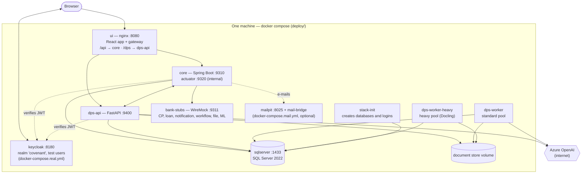
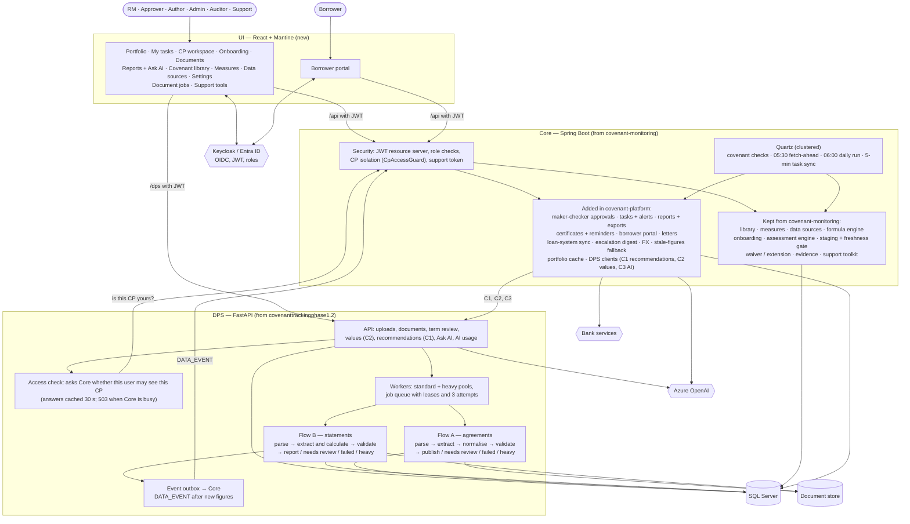
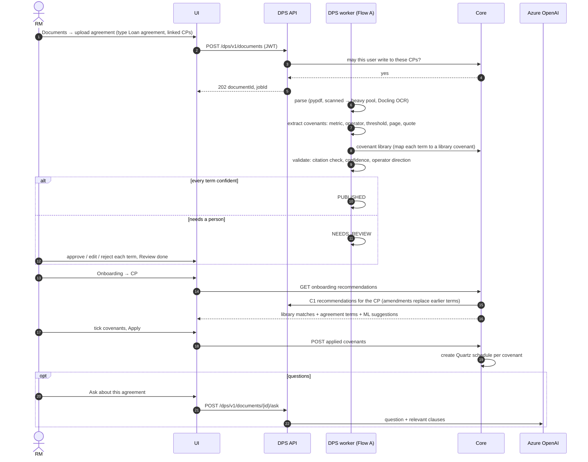
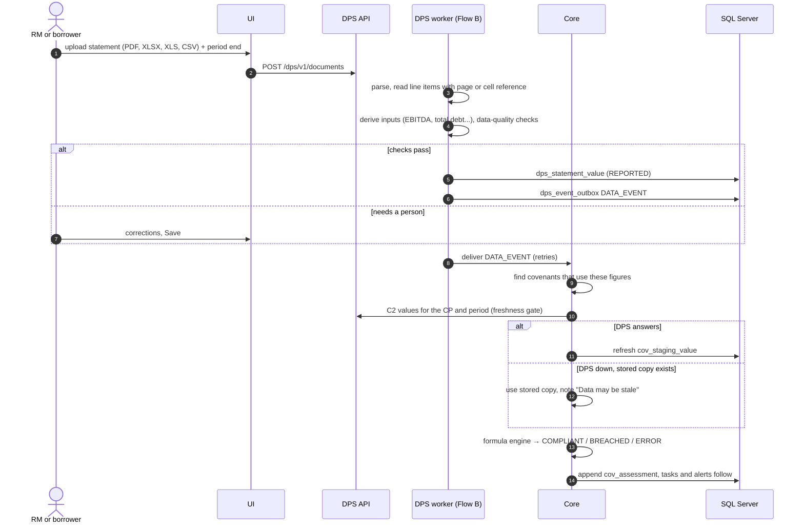
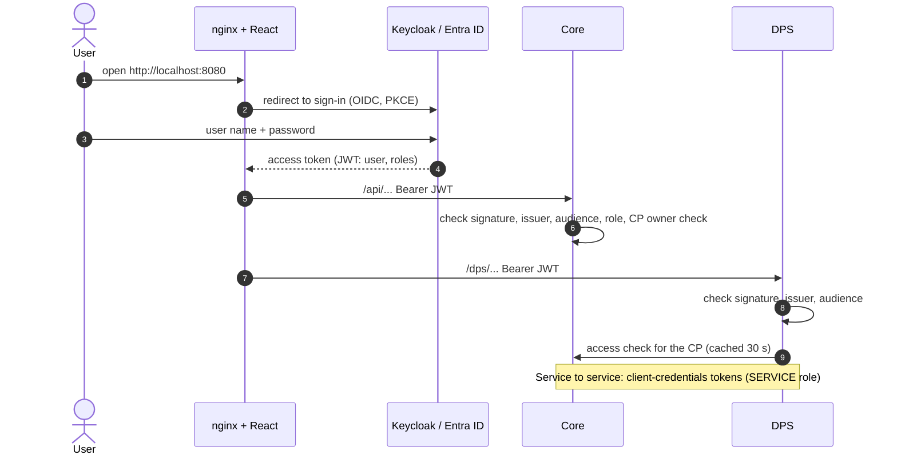
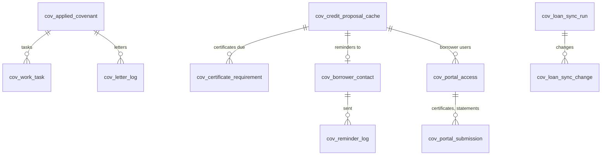
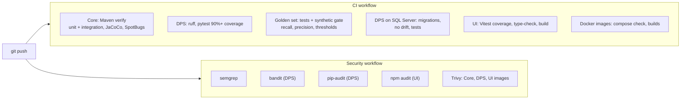

# covenant-platform — Covenexa (the product built on both apps)

| | |
|---|---|
| Built by | Our team, on top of [covenanttrackingphase1.2](covenanttrackingphase1.2.md) and [covenant-monitoring](covenant-monitoring.md) |
| Location | `C:\Users\vishw\covenant-platform`, GitHub `Vishwas2311/loan-covenant-platform` |
| Folders | `core/` (Java service), `dps/` (Python service), `ui/` (React app), `deploy/` (Docker Compose, Keycloak realm, stubs, mail bridge), `golden-set/` (extraction test set), `loadtest/`, `docs/` |
| In one line | covenant-monitoring became **Core**, the system of record that decides compliance; covenanttrackingphase1.2 became the **Document Processing Service (DPS)**, which reads agreements and statements; a new UI, real sign-in, borrower portal and production packaging were built around them |

Back to the [overview](README.md). What each page does for a user: [user-guide.md](../user-guide.md).

## 1. Technology stack, and where each piece came from

| Layer | Technology | Came from |
|---|---|---|
| UI | React 18, Mantine, TanStack Query, Vite build; served by **nginx**, which is also the gateway on port 8080 (`/api` → Core, `/dps` → DPS) | New |
| Sign-in | OpenID Connect: **Keycloak 26** locally, **Microsoft Entra ID** in production; JWT on every call; roles RM, APPROVER, AUTHOR, ADMIN, AUDITOR, SUPPORT, BORROWER | New |
| Core | Java 17, Spring Boot 3.5, Spring Security (JWT resource server), JPA, Quartz (clustered in production), formula engine, Flyway `V1`–`V32` | covenant-monitoring, extended |
| DPS | Python 3.12, FastAPI, **CrewAI Flows** (Flow A agreements, Flow B statements), SQLAlchemy + Alembic, pypdf, RapidOCR, **Docling** (heavy pool), openpyxl, xlrd | covenanttrackingphase1.2, rebuilt |
| AI | **Azure OpenAI**: Ask AI, agreement questions, narratives, AI suggestions; token use stored per call | Both, consolidated |
| Database | **SQL Server 2022** (Core's `covenant` database and DPS's tables), `READ_COMMITTED_SNAPSHOT` on | covenant-monitoring |
| Files | Document store volume for original PDFs and spreadsheets | New |
| Bank services | Credit-proposal, loan, notification, workflow, file and ML services; **WireMock** stand-ins locally | covenant-monitoring |
| Packaging | Docker images for Core, DPS (standard and heavy) and UI; Docker Compose; optional Mailpit and two-node files | New |
| CI | GitHub Actions: build and tests, coverage gates, SpotBugs, golden-set gate, bandit, semgrep, pip-audit, npm audit, Trivy image scan | New |

## 2. Deployment (local Docker stack)

In production the same images run on the bank's platform, Keycloak is replaced by Entra ID, WireMock by
the bank's real services, and Core can run as several nodes (`docker-compose.scale.yml` shows two).

## 3. Component architecture

## 4. Journey A — loan agreement to monitored covenants

## 5. Journey B — statement figures to a covenant result

## 6. Sign-in and authorisation

## 7. What runs by itself

```mermaid
gantt
    title Daily timetable (India Standard Time)
    dateFormat HH:mm
    axisFormat %H:%M
    section Every 5 minutes
    Task sync (tasks and alerts for every CP) :t1, 00:00, 24h
    section Per covenant
    Own scheduled check, spread over the hour :c1, 02:00, 60m
    section Portfolio
    Fetch-ahead for covenants due in 3 days :p1, 05:30, 20m
    Daily run — loan sync, checks, RM summaries, reminders, reports, escalation :p2, 06:00, 30m
```

Also continuous: DPS workers read every upload; a new or corrected statement triggers re-checks within
seconds; the DPS outbox retries delivery to Core.

## 8. Data model added on top of covenant-monitoring

New Core tables, added to covenant-monitoring's 23:

New Core tables: `cov_work_task`, `cov_saved_report`, `cov_certificate_requirement`,
`cov_borrower_contact`, `cov_reminder_log`, `cov_portal_access`, `cov_portal_submission`,
`cov_letter_log`, `cov_loan_sync_run`, `cov_loan_sync_change`, `cov_data_event`, `cov_fx_rate`,
`cov_manual_run` (36 `cov_*` tables in all, up from 23). DPS tables: `dps_document`,
`dps_document_cp_link`, `dps_job`, `dps_extracted_term`, `dps_statement_value`, `dps_event_outbox`,
`dps_audit_event`, `dps_ai_usage`, `dps_flow_state`.

## 9. Build and quality pipeline

## 10. What came from where

| Capability | From covenanttrackingphase1.2 | From covenant-monitoring | New in covenant-platform |
|---|---|---|---|
| Reading loan agreements | Regex extraction, OCR | — | Flow A, citation check, review screen, amendments, security covenants |
| Reading statements | Excel/PDF reading, ratio formulas, metric aliases | — | Flow B, cell references, data-quality checks, `.xls`, corrections, Values API (C2) |
| Covenant rules | Master covenant list, custom formulas | Library, eligibility, formula language, measures, data sources | Agreement terms feed onboarding |
| Checking covenants | One run per upload | Quartz, assessment engine, staging | Spread schedules, clustered scheduler, re-check on new data, stale-figures fallback |
| Breach workflow | Human review of breaches | Waiver / extension, evidence, AI suggestions | Maker-checker, tasks, alerts, letters, escalation digest |
| AI | 7 CrewAI agents on gpt-4.1 | AI status-suggestion client | Azure OpenAI, Ask AI limited to the user's CPs, agreement Q&A, token tracking |
| Users and security | None | `X-User` header | OIDC sign-in, 7 roles, CP isolation in Core and DPS, support token |
| Borrowers | — | — | Borrower portal, reminders, certificate tracking |
| Storage | JSON files | H2 / SQL Server | SQL Server for both services, document store |
| Operations | Run from a terminal | Support toolkit | Docker images, runbook, CI security gates, load-tested on one and two Core nodes |
