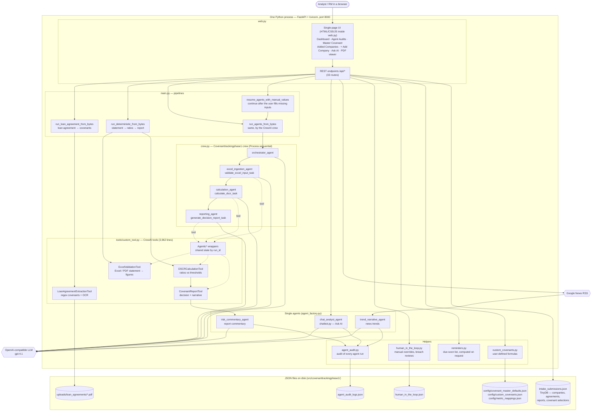
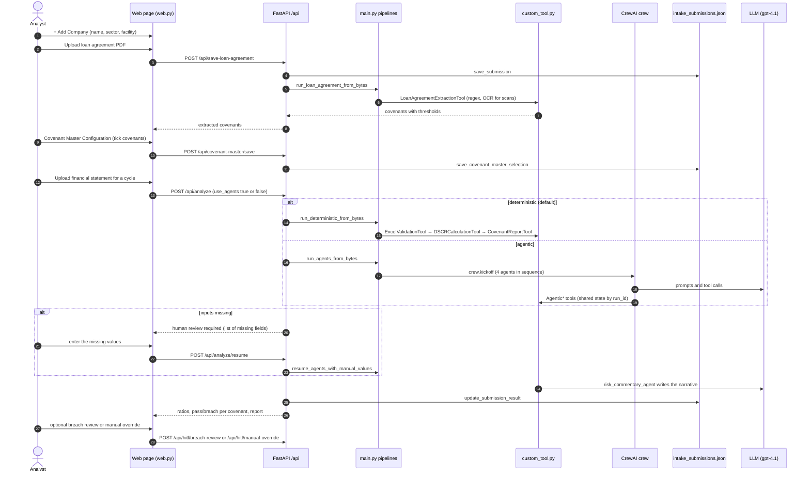
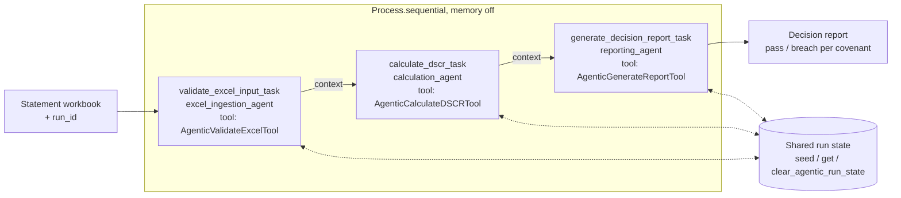
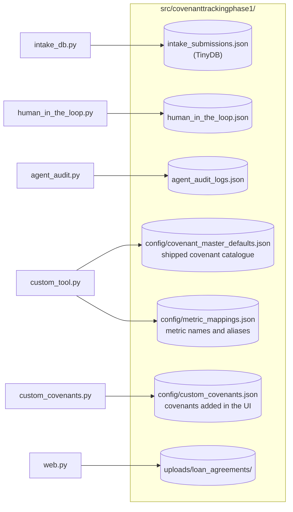

# covenanttrackingphase1.2 — "Covenant automatic tracking" (our original app)

| | |
|---|---|
| Built by | Our team |
| Location | `C:\Users\vishw\OneDrive\Desktop\covenanttrackingphase1.2` (a plain folder, not a git repository) |
| Read from | `HANDOFF.md`, `requirements.txt`, `src/covenanttrackingphase1/` (web.py, main.py, crew.py, tools/custom_tool.py, intake_db.py, chatbot.py, reminders.py, human_in_the_loop.py, agent_audit.py, config/*.yaml) |
| In one line | A single Python web app that reads one company's loan agreement and financial statements, works out its covenant ratios and writes an AI-assisted compliance report |

Back to the [overview](README.md).

## 1. Technology stack

| Layer | Technology | Where |
|---|---|---|
| Language | Python 3.12 (3.11–3.13 work) | `HANDOFF.md` §1 |
| Web server | FastAPI 0.136 on Uvicorn, one process, port 8000 (next free port up to +20) | `web.py`, `serve()` |
| User interface | One HTML page generated by Python: HTML, CSS and JavaScript are strings inside `web.py` (10,305 lines); no front-end framework; charts are hand-drawn SVG; pdf.js 3.11 (CDN) shows agreement pages; Google Fonts | `web.py` |
| AI agents | CrewAI 1.13: one crew of 4 agents run in sequence, plus 3 single agents; all on `openai/gpt-4.1` through any OpenAI-compatible API | `crew.py`, `config/agents.yaml`, `config/tasks.yaml`, `agent_factory.py` |
| PDF reading | pypdf (text PDFs); pypdfium2 + RapidOCR (ONNX) for scanned pages | `tools/custom_tool.py` |
| Spreadsheet reading | openpyxl + pandas | `tools/custom_tool.py` |
| Covenant extraction | Regular expressions (no LLM) | `LoanAgreementExtractionTool` |
| Storage | No database server: TinyDB over JSON files, plus plain JSON files | `intake_db.py`, `human_in_the_loop.py`, `agent_audit.py` |
| News | Google News RSS | `web.py` `_fetch_google_news_rss` |
| Configuration | `.env` (OpenAI key, base URL, model) | `HANDOFF.md` §3 |
| Sign-in, roles | None | — |
| Scheduler, e-mail | None | — |

## 2. Component architecture

## 3. Main journey: one company from start to report

## 4. The CrewAI crew (agentic mode)

The orchestrator agent is declared in the crew; the three tasks are bound to the ingestion, calculation
and reporting agents. The deterministic mode runs the same tools directly, without any LLM.

## 5. Where data lives

## 6. API map

| Area | Endpoints |
|---|---|
| Page and files | `GET /`, `GET /static/crisil-logo.png`, `GET /api/loan-agreement-file`, `GET /loan-pdf-viewer` |
| Companies and portfolio | `GET /api/companies`, `/api/company-status`, `/api/portfolio-overview`, `/api/company-cycles`, `/api/company-reports`, `/api/company-cycle-matrix-export` |
| Covenant master | `GET /api/covenant-master`, `GET /api/covenant-master/export`, `POST /api/covenant-master/save` |
| Custom covenants | `GET/POST /api/custom-covenants`, `PUT/DELETE /api/custom-covenants/{id}` |
| Documents and analysis | `POST /api/save-loan-agreement`, `POST /api/analyze`, `POST /api/analyze/resume`, `POST /api/upload-compliance-certificate`, `POST /api/upload-non-financial-evidence` |
| Status | `GET /api/covenant-reminders`, `/api/compliance-certificate-status`, `/api/non-financial-evidence-status` |
| Human in the loop | `GET /api/hitl/context`, `POST /api/hitl/manual-override`, `POST /api/hitl/breach-review` |
| AI and audit | `POST /api/chat`, `GET /api/financial-news`, `GET /api/agent-audits/agents`, `/logs`, `/timeline` |

## 7. What it did well, and what it lacked

| Did well | Lacked (why it could not go to a bank as it was) |
|---|---|
| Read loan agreements and statements, including scans | One process; JSON files instead of a database; one user at a time |
| Ratio calculation with missing-input prompts (human in the loop) | No sign-in, roles or isolation between RMs |
| AI narratives, Ask AI, news trends, full agent audit | No scheduler, no e-mails; reminders only computed when a page asks |
| Simple to run on a laptop | No library rules engine, no assessment history across periods at bank scale, no tests or CI gates |

These parts became the **Document Processing Service (DPS)** in covenant-platform; see
[covenant-platform.md](covenant-platform.md).
