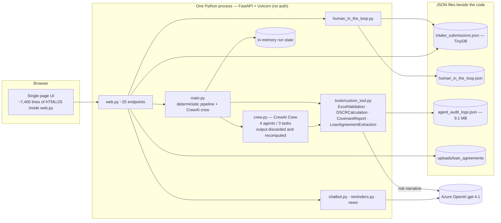
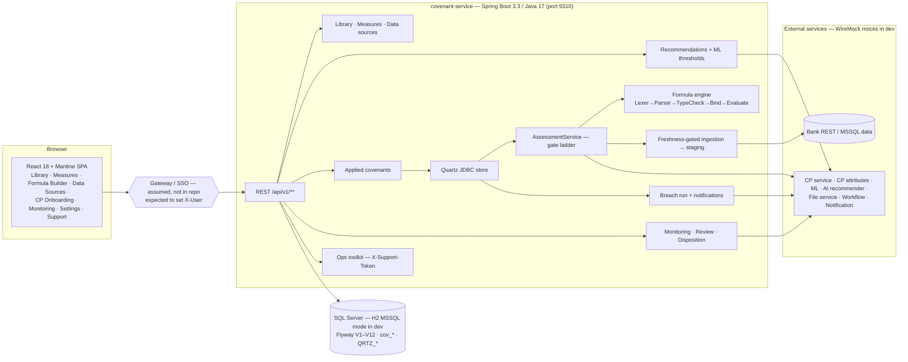

# 01: Current State of Both Applications

Verified 2026-11-02 by reading the code and running both apps (see [verification.md](verification.md)). "Confirmed" means the problem was observed in stored data or reproduced at runtime.

---

## A. Our app: covenant automatic tracking (`covenanttrackingphase1.2`)

### A.1 What it does
1. Reads a **loan-agreement PDF** and extracts covenants: metric, operator, threshold, formula, page and quote. It uses regular expressions, not an LLM.
2. Lets the user choose which covenants apply ("Covenant Master Configuration").
3. Reads a **financial statement** (Excel Field/Value layout or labelled PDF) for one reporting period and computes each ratio.
4. Decides COMPLIANT / BREACH / NOT_EVALUATED, adds a trend, a confidence score and an **LLM risk narrative** (Azure OpenAI gpt-4.1).
5. Offers human-in-the-loop overrides and waivers, evidence uploads, a dashboard, reminders, chat and a news panel.

### A.2 Architecture today

Important: the project uses a **CrewAI Crew** (agents + tasks), **not CrewAI Flows**. The crew's output is thrown away and every number is recomputed in plain Python (`main.py:_deterministic_handoff_from_step1`). So the agents add LLM cost and no decisions.

### A.3 Strengths worth keeping
| Strength | Where |
|---|---|
| Agreement extraction with page + quote (works offline, 1–6.5 s per sample PDF) | `LoanAgreementExtractionTool` |
| Non-financial covenant detection (insurance, negative pledge, reporting, certificates…) | `_extract_non_financial_covenants` |
| Statement parsing incl. OCR fallback | `ExcelValidationTool` |
| Safe formula evaluator (AST whitelist) | `DSCRCalculationTool._compute_metric` |
| Advisory LLM narrative with deterministic fallback | `CovenantReportTool._build_llm_report` |

### A.4 Verified problems (IDs from the app review)
| ID | Problem | Evidence |
|---|---|---|
| F-01 | Waiving one metric marks the whole report COMPLIANT | 9 stored reports |
| F-02 | Manual override sets overall decision to the primary metric only | Code |
| F-03 | Any uploaded file makes a non-financial covenant COMPLIANT; file is discarded | Reproduced at runtime (junk bytes accepted) |
| F-04 | XSS in `/loan-pdf-viewer` | Reproduced at runtime |
| F-05 | No authentication | Runtime: all endpoints open |
| F-06 | Reminders use the oldest cycle date | Data replay |
| F-07 | Overall COMPLIANT while some covenants NOT_EVALUATED | 2 stored reports |
| F-08 | Risk-narrative LLM called twice per agent run | 172 calls for 71 reports |
| F-09 | Long work blocks the async web server | Code |
| F-10/F-13 | JSON storage with two locks; company ID collisions | Code + data |
| F-15 | Units and % dropped from thresholds | Replay |
| A-06 | Only 7 statement line items parsed | Code |
| — | No tests at all | Repository |

---

## B. Their app: covenant-monitoring (other team)

### B.1 What it does
1. **Covenant library:** reusable covenants with eligibility rules and a formula language (`TOTAL_DEBT / EBITDA <= 3.5`, `AVG(EBITDA, 4Q) >= 1000000`, `%`, dates, AND/OR, fiscal-year periods). Each covenant is either AUTO or MANUAL.
2. **Measures and data sources:** maps measure names to bank REST APIs or SQL Server tables. Copies data into a staging table (`cov_staging_value`) before assessment.
3. **CP onboarding:** recommends covenants per credit proposal (CP); an ML service suggests thresholds; the RM adjusts and applies.
4. **Scheduling:** a Quartz job per applied covenant, a 05:30 data pre-stage and a 06:00 breach sweep.
5. **Assessment:** append-only rows. AUTO covenants go through a gate ladder: compile → data → missing → evaluate, giving COMPLIANT / BREACHED / ERROR. MANUAL covenants wait for a person (result + mandatory note).
6. **Monitoring:** By-CP scorecard, By-Covenant agenda, per-CP review grid with headroom.
7. **Disposition:** Waiver/Extension per covenant, tied to the latest assessment; evidence goes to a file service; optional AI status suggestions.
8. Morning RM/WRM emails, one workflow case per CP, full audits, and a support toolkit (diagnose, re-ingest, re-assess, purge).

### B.2 Architecture today

### B.3 Strengths
| Strength | Evidence |
|---|---|
| Quality gates enforced and passing | 964 unit + 40 IT, 97.2 % line / 89.2 % branch, SpotBugs 0 |
| Correct decision rules: missing data ⇒ ERROR, never BREACH; MANUAL needs a note; waiver per covenant | Code + live run |
| Append-only, immutable assessments with snapshot and evaluated formula | `AssessmentService` |
| Clear integration contracts (REST data source, ML recommender, AI recommender, file service) | Code; REST contract proven live |
| Formula language with time windows and fiscal calendar | `formula/*` |

### B.4 Verified gaps
| ID | Gap | Evidence |
|---|---|---|
| T-SEC-1 | Identity is whatever `X-User` says; no Spring Security | `CurrentUserContext`, `pom.xml` |
| T-SEC-2 | Review grid and assessment list are readable without identity | Live probe |
| T-SEC-3 | Waiver accepted without identity (audited as `system`) | Live probe |
| T-SEC-4 | Support token defaults to `dev-support-token` in every profile when the env var is unset; it also unlocks CP data purge | `application.yml`, live probe 200 |
| T-RULE-1 | Extension with a past date accepted | Live probe |
| T-RULE-2 | `LATEST(x)` with no window accepts a value of any age | `MeasureAggregationResolver` |
| T-RULE-3 | An ERROR run counts as "assessed", so a late statement waits until the next cron date | `BreachNotificationService.isDue` |
| T-FEAT-1 | No document intake: covenants are typed by hand | Code search |
| T-FEAT-2 | AI/ML/workflow/notification/file services are mocks | WireMock mappings |
| T-OPS-1 | Quartz `isClustered: false` (single instance) | `application.yml` |

---

## C. Side-by-side

| Area | Ours | Theirs |
|---|---|---|
| Covenant terms come from | Agreement PDF (automatic) | Typed into the library |
| Financial numbers come from | Uploaded statement (1 period, 7 fields) | Bank systems (time series) |
| Formula | Python AST, single period | DSL with windows, fiscal periods |
| Decision states | COMPLIANT / BREACH / NOT_EVALUATED (aggregation buggy) | COMPLIANT / BREACHED / ERROR / PENDING_REVIEW / NA |
| Waiver | Whole report (bug) | Per covenant, tied to latest assessment |
| Scheduling | Fixed 90-day guess | Quartz per covenant |
| Storage | JSON files | SQL Server + Flyway |
| Orchestration | CrewAI Crew (ornamental) | Quartz + services |
| LLM use | Narrative, chat, news | None in code (external AI/ML contracts) |
| Tests | None | 1,004 backend + 435 frontend |

**Conclusion:** the two apps complement each other. Ours is good at **reading documents** and weak at **monitoring**. Theirs is the opposite. The target architecture ([02](02-target-architecture.md)) uses each for its strength.

### C.1 Terminology clashes to fix
| Word | Ours means | Theirs means | Combined meaning |
|---|---|---|---|
| Cycle | Reporting period (Q1) | CP renewal lineage (`parentCpId`) | "Cycle" = their meaning. Reporting period = **statement `asOfDate`** |
| Company / facility | `BRW-n` / `FAC-n` generated by us | Obligor / CP from the CP service | Use **obligorId / cpId**; stop generating IDs |
| Master | Our 42-row JSON copy | Their library table | Their library is the only master |
| Metric key | `ICR`, `NET_LEVERAGE_RATIO` … | `INTEREST_COVER`, `NET_LEVERAGE` … | Their measure codes; mapping in [04](04-api-contracts.md) |
