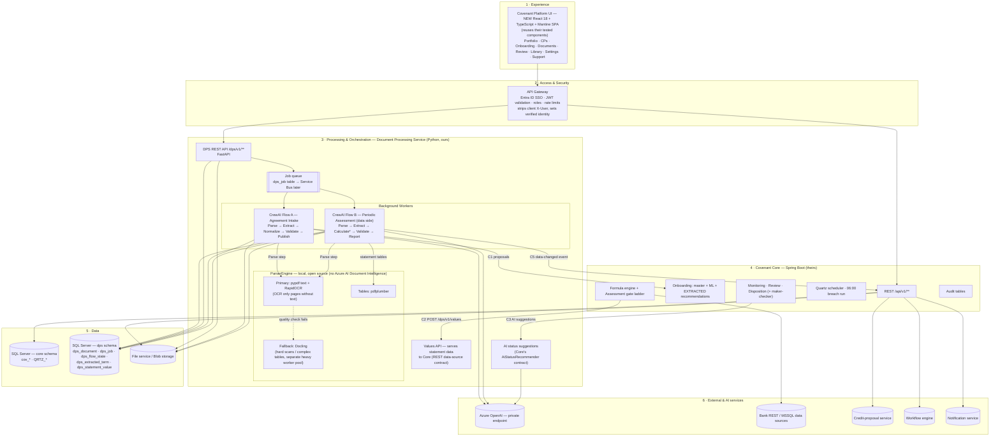
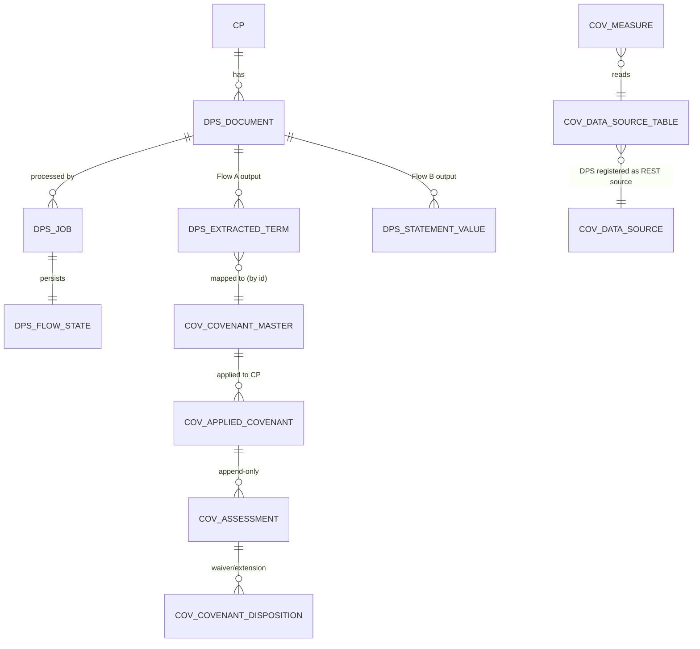
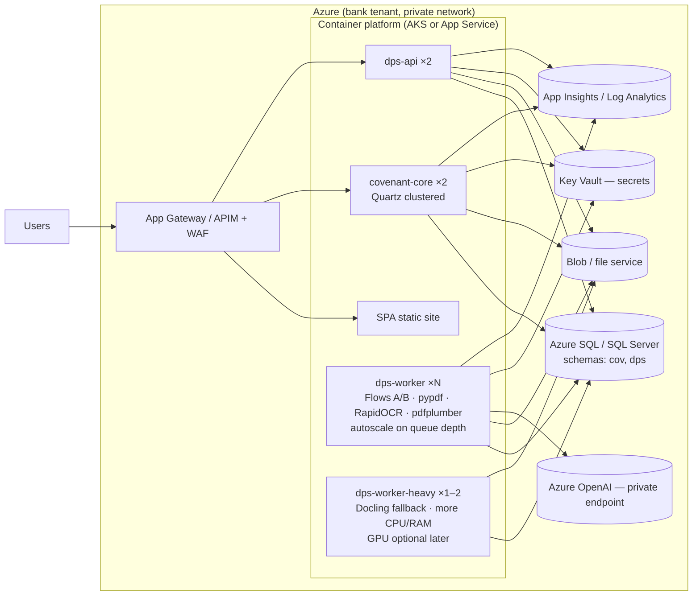

# 02: Target Architecture (Combined Product)

## 1. Principles
1. **One brain for decisions.** Only Covenant Core calculates covenant results and decides COMPLIANT / BREACHED / ERROR, waivers and extensions. Nothing else may write a compliance status.
2. **Documents become facts, not verdicts.** The Document Processing Service (DPS) turns documents into *proposed covenants* and *financial values*, each with its source page or cell and a confidence score.
3. **Humans approve.** Extracted covenants never become active without RM confirmation. Low-confidence data goes to review, not to Core.
4. **Reuse existing contracts.** DPS plugs into Core through interfaces Core already has: REST data source, recommender pattern, AI recommender and file service. Core changes stay small.
5. **Never block the user.** Long work (PDF parsing, OCR, LLM) runs in background workers. Core keeps working if DPS is down.
6. **Secure by default.** SSO at the gateway **and** checks in each service; portfolio isolation on every CP endpoint; no default secrets.

## 2. Layered architecture

The layers follow the manager's numbering ("3 = Processing & Orchestration").

`*` "Calculate" in Flow B computes **derived financial inputs only**, e.g. Total Debt = short-term + long-term debt. It does **not** compute covenant ratios against thresholds. That happens in Core (see [03](03-flows-design.md) §3).

## 3. Components and responsibilities

| Component | Owner | Responsibility | Must NOT do |
|---|---|---|---|
| **New UI (SPA)** | Our team (decision D1/D12) | One new UI for the combined product, built with React 18 + TypeScript + Mantine + TanStack. Reuses their formula builder, frequency picker, disposition and threshold components. Covers every screen in [07](07-feature-inventory.md) | Call DPS directly except through the gateway; hold business rules |
| API gateway | Platform / infra | SSO, token validation, identity header, rate limits | Business logic |
| **DPS API** | Our team | Accept documents, create jobs, report job status, serve values and suggestions | Decide compliance |
| **Flow A** | Our team | Agreement → covenant proposals with citations → publish to Core onboarding | Activate covenants |
| **Flow B** | Our team | Statement → validated line-item values per period → store → notify Core; advisory narrative | Compare against thresholds or set status |
| Background workers | Our team | Run flows from the queue, retries, timeouts, concurrency limits | Run in the web process |
| **ParserEngine** | Our team | Turn files into page text, OCR lines and table cells with page/coordinates. Primary pypdf + RapidOCR; pdfplumber for tables; Docling fallback for hard documents (see [03](03-flows-design.md) §8) | Send documents outside the bank network; use cloud document-AI services |
| **Covenant Core** | Their team | Library, onboarding, applied covenants, schedules, assessments, dispositions, notifications, audits, ops | Parse documents |
| SQL Server | Infra | Two schemas, one per service; no cross-schema writes | — |
| File service | Infra / their team | One store for all documents and evidence; both services reference `fileId` | — |
| Azure OpenAI | Infra | LLM for extraction help, narratives, AI suggestions; private endpoint; no training on data | — |

## 4. Data ownership

| Data | Owner | Copy allowed? |
|---|---|---|
| Documents (bytes) | File service | No; reference by `fileId` |
| Document metadata, jobs, flow state, extracted terms, statement values | DPS schema | Core reads values only via C2 (staged into `cov_staging_value`, which is Core's design) |
| Covenant library, applied covenants, assessments, dispositions, audits | Core schema | DPS reads library via Core API (C4) only |
| CP / obligor / RM identity | CP service | Both cache read-only |

Keys: `cpId` (credit proposal) and `obligorId` from the CP service. Reporting period = `asOfDate` (period end date).

## 5. Main runtime interactions

| # | Interaction | Direction | Contract |
|---|---|---|---|
| C1 | Covenant proposals for onboarding | Core → DPS (pull, during onboarding) | `POST /dps/v1/recommendations` |
| C2 | Financial values for assessment | Core → DPS (Core's existing REST data source) | `POST /dps/v1/values` |
| C3 | AI status suggestions for breaches/manual items | Core → DPS | `POST /dps/v1/ai-suggestions` |
| C4 | Read library and measures for mapping | DPS → Core | `GET /api/v1/covenants`, `GET /api/v1/measures` |
| C5 | "New data for CP" event → re-assess | DPS → Core | **New Core endpoint** `POST /api/v1/data-events` |
| C6 | Files | Both → file service | Existing file-service API |

Full payloads: [04-api-contracts.md](04-api-contracts.md).

## 6. Deployment view

**Deployment target is not decided yet (D10).** Everything is built as Docker images with environment-based configuration and SQL Server, so it runs in the bank's Azure tenant (shown below as the reference) or on-premises (Kubernetes / VMs + on-prem SQL Server). The LLM provider sits behind an `LlmClient` interface in case Azure OpenAI is not reachable on-prem.

- Two instances of Core need **Quartz clustering** (`isClustered: true`, JDBC store already used).
- DPS workers scale on queue depth. DPS API is stateless.
- Two worker pools. **dps-worker** runs every job with the fast local parsers (about 0.1 s per text page measured). **dps-worker-heavy** takes only jobs routed to the Docling fallback; it measured about 6–7 s per page on CPU, so it is kept separate so slow jobs never delay normal ones.
- **No document-AI cloud service.** Parsing and OCR run inside the worker containers. Only text that needs an LLM step goes to Azure OpenAI.
- Secrets live in Key Vault: DB, OpenAI, support token. No defaults in code.
- One correlation id passes through gateway → Core → DPS → worker → OpenAI for tracing.

## 7. Security architecture

| Control | Where | Fixes |
|---|---|---|
| Entra ID SSO, JWT validated at gateway | Gateway | Their T-SEC-1, our F-05 |
| JWT also validated inside each service (Spring Security resource server / FastAPI dependency) | Core, DPS | Defence in depth if the gateway is bypassed |
| Roles: RM, APPROVER, AUTHOR, SUPPORT, AUDITOR, SERVICE | Gateway claims → services | Waivers need APPROVER (maker-checker) |
| Portfolio check on **every** CP-scoped read and write | Core service layer | Their T-SEC-2, T-SEC-3 |
| Service-to-service auth (client credentials) between Core and DPS | Both | Values/recommendation APIs not open to browsers |
| No default secrets; startup fails if missing | Both | Their T-SEC-4 |
| CSP, output encoding; one source viewer in the new UI (pdf.js, escaped values) | SPA | Our F-04 |
| Upload limits: type, size, page count; parse in worker with timeout | DPS | Our A-09 |
| LLM: private endpoint, minimum text sent, prompts logged with retention limit | DPS | Our A-07/A-08 |
| Audit: every proposal, apply, assessment, disposition, override with user + source document | Both | Their append-only design + DPS run records |

## 8. What is retired from our app
| Retired | Replaced by |
|---|---|
| `web.py` UI, dashboard, reminders, HITL, waivers, evidence status | Core screens and rules |
| TinyDB JSON files | SQL Server `dps` schema + Core schema |
| CrewAI **Crew** (`crew.py`, 4 agents) | CrewAI **Flows** A and B (agent calls only inside steps that need an LLM) |
| Our compliance calculation and overall decision | Core gate ladder |
| Our 42-row covenant catalog | Core library (read via C4) |
| Chat / news | Optional phase 3, reading Core APIs |

## 9. Alternatives considered
| Option | Why not chosen |
|---|---|
| Patch our app to match Core's features | Months to reach their level; two engines would drift |
| Rewrite our extraction in Java inside Core | Loses Python PDF/OCR/LLM ecosystem; 4–6 months |
| Let Flow B also calculate and decide compliance | Two systems would give two answers for one covenant |
| Vector DB / RAG for documents | No retrieval problem found; documents are processed one at a time |
| Azure AI Document Intelligence / Azure Content Understanding for parsing | Excluded by decision. The local stack keeps documents inside the network at no per-page cost; Docling covers hard documents ([03](03-flows-design.md) §8) |
| Docling as the only parser | Same numbers as pypdf on our samples but about 45–55× slower on CPU; used as fallback only |
