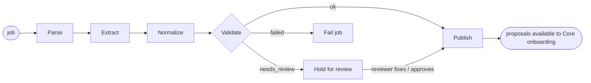
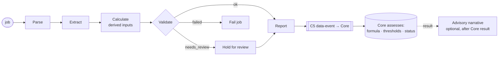

# 03: Processing & Orchestration (CrewAI Flows and Background Workers)

This is the detailed design of layer 3 from the manager's diagram:

```
Run Intake ──► CrewAI Flow A – Agreement Intake:      Parse → Extract → Normalize → Validate → Publish
Run Assessment ► CrewAI Flow B – Periodic Assessment: Parse → Extract → Calculate → Validate → Report
                 Background Workers
```

## 1. Why Flows, and what changes from today

| Today (Crew) | Target (Flows) |
|---|---|
| `crew.py`: 4 agents and 3 tasks. Every run makes several LLM calls; the output is discarded and recomputed | Each box is a Python step. An LLM/agent is called **only** in Extract (optional) and Report |
| Run state lives in a process-memory dict (`_RUN_STATE`), lost on restart | Pydantic state saved by `@persist` to SQL Server; a run can resume by id |
| Pause for missing input exists only in memory | `@router` sends the run to a `needs_review` branch; it resumes from the saved state after a person acts |
| Risk narrative generated twice per agent run (F-08) | One Report step, called once |
| Work runs inside the web request (F-09) | The web API only queues a job; background workers run the flow |
| No per-stage timing or errors | Each step records start/end/error to the run record |

Verified in the installed `crewai==1.13.0`: `Flow`, `start`, `listen`, `router`, `or_`, `and_`, `persist`, `human_feedback` and `kickoff_async` all import. The `FlowPersistence` interface has `init_db`, `save_state`, `load_state`, `save_pending_feedback`, `load_pending_feedback` and `clear_pending_feedback`, so a SQL Server backend can be written. The current CrewAI docs say routers should declare their labels (`Literal[...]` or `emit=[...]`) so `flow.plot()` can draw the branches. Per AGENTS.md, re-check the docs/changelog before coding. PyPI latest was 1.15.34 on 2026-11-02.

## 2. Flow A: Agreement Intake

**Trigger ("Run Intake"):** a user uploads a loan agreement for a CP (`POST /dps/v1/documents`, type `LOAN_AGREEMENT`). The DPS API stores the file, creates a `dps_job`, and returns `202 {jobId}`. A worker picks the job up.



| Step | What it does | Code source (today) | LLM? | Output in state |
|---|---|---|---|---|
| **Parse** | Get bytes by `fileId`. Per page: native text (pypdf); OCR **only for pages with no or garbled text** (fixes F-17). Parsing goes through a pluggable `ParserEngine` interface; see §8 for which engine and why | `_extract_pdf_text`, `_extract_pdf_text_with_ocr`, `_extract_pdf_pages_text` | No | `pages[{no, text, method, quality}]` |
| **Extract** | Find covenants: numbered clauses → metric, operator, threshold, unit, formula, frequency, due days; non-financial rules. **Optional LLM pass** proposes extra terms as JSON *with an exact quote and page* | `_extract_terms_from_text`, `_extract_non_financial_covenants`, `_extract_min_networth_terms`, `_attach_term_sources` | Optional | `terms[{metric_raw, op, value, unit, formula_raw, frequency, page, quote, method: REGEX/LLM}]` |
| **Normalize** | Map our metric keys to Core measure codes and master ids (read via C4). Convert units to the measure's unit. Rewrite the formula in Core's DSL (`DSCR >= 1.25`). Unmatched → candidate custom covenant | New mapper (table in [04](04-api-contracts.md) §6) | No | `proposals[{covenantMasterId|null, expression, unit, frequency, source}]` |
| **Validate** | Deterministic checks: (1) the quote exists on the cited page; (2) the number in the quote equals the threshold; (3) the expression is valid in Core (`POST /api/v1/formulas/validate`); (4) no duplicate metric with a different value unless step-down language exists; (5) confidence ≥ threshold | New | No | `issues[]`, `confidence` per proposal; route label |
| **Publish** | Store proposals in `dps_extracted_term` with status `PUBLISHED`. They are **pulled** by Core onboarding through C1. Notify the UI that the job is done | New | No | `published_count` |

**Router labels:** `publish`, `needs_review`, `failed`.
- `needs_review` holds the run when a quote can't be found, a threshold conflicts, or confidence is low. The Extraction Review screen shows the terms with their page; the reviewer edits or approves, then the run resumes at Publish. Rejected terms are kept with the reason.
- `failed` is used for an unreadable PDF or zero text after OCR.

**Rule:** Flow A never applies a covenant. Activation happens only when the RM confirms the onboarding grid in Core (`thresholdSource = EXTRACTED`, or `USER` if edited).

## 3. Flow B: Periodic Assessment (data side)

**Trigger ("Run Assessment"):** one of
- the user uploads a financial statement for a CP and period end (`POST /dps/v1/documents`, type `FINANCIAL_STATEMENT`, `asOfDate`);
- a scheduled pull (phase 3) of statements from a bank document store;
- a re-run requested by support.



| Step | What it does | LLM? | Notes |
|---|---|---|---|
| **Parse** | Same `ParserEngine` as Flow A. PDF tables via **pdfplumber**; Excel via pandas (all sheets and rows, not just the first row); Docling fallback when no usable table is found | No | Today only Field/Value sheets and the first row are read (A-06). Extend to statement tables |
| **Extract** | Line items per period: revenue, EBITDA, interest paid, principal paid, total debt (ST/LT), net worth, tangible assets, current assets/liabilities, cash, inventory… with source cell/page | No (optional LLM for unusual layouts, quote-checked) | Today: 7 fields. Target: the statement line-item catalog in [04](04-api-contracts.md) §6.2 |
| **Calculate** | **Derived inputs only**: Total Debt = ST + LT; EBITDA = EBIT + D&A if not reported; LTM sums from quarters; unit and currency conversion | No | **Does not** compute covenant ratios against thresholds and **does not** decide COMPLIANT/BREACH. Core does that with its own formulas |
| **Validate** | Data-quality checks: balance sheet balances (±tolerance); period end matches `asOfDate`; no negative values where impossible; YoY jumps flagged; required items for this CP's applied covenants present (from C4) | No | Missing required item → `needs_review`. Never sends an invented value |
| **Report** | (1) Save values in `dps_statement_value` (versioned; a new upload for the same period supersedes the old one). (2) Bump `sourceChangedAt`. (3) Send **C5 data-event** to Core so it re-assesses now (fixes T-RULE-3). (4) Optional: after Core's result is available, generate the **advisory narrative** (our risk-commentary prompt), clearly labelled "AI, not a decision" | Yes (narrative only) | The narrative never changes a status |

**Who calculates covenant ratios?** Core. When Core runs an assessment, it calls C2 `POST /dps/v1/values {cpId, from, to, keys}`. DPS returns the stored line items; Core evaluates e.g. `EBITDA / (INTEREST_PAID + PRINCIPAL_PAID) >= 1.25`. This was proven with a live run.

**If the manager prefers Flow B to show ratios before Core runs:** this needs a small **new Core endpoint**, e.g. `POST /api/v1/formulas/dry-run {expression, values}`. It would evaluate a formula against supplied values without storing anything. Core's existing `POST /api/v1/formulas/validate` cannot be used for this: it only takes `{expression, requireBoolean}` and evaluates against built-in sample values (`FormulaEngine.buildSample`). Any preview must be labelled "preview"; the official status comes only from Core's assessment.

## 4. Background Workers

| Item | Design |
|---|---|
| Queue | Phase 1: `dps_job` table in SQL Server (status QUEUED/RUNNING/NEEDS_REVIEW/DONE/FAILED, attempts, locked_by, locked_until). Workers claim jobs with `UPDATE … WITH (READPAST, UPDLOCK)`. Phase 3 option: Azure Service Bus if volume requires |
| Worker process | `dps-worker` container: loop → claim job → `flow.kickoff(inputs={"id": job.flow_state_id, …})` → update job |
| Heavy pool | `dps-worker-heavy` claims only jobs flagged `needs_docling` (set when the Parse quality check fails: low OCR confidence, no usable table, scrambled reading order). The flow resumes from saved state after the heavy parse, so the other steps run as normal |
| Concurrency | N workers × 1 job each; OCR/LLM limited by a semaphore per worker; LLM calls rate-limited |
| Timeouts | Per step: fast Parse 120 s / 50 pages; Docling Parse 10 s per page (measured about 6–7 s per page on CPU); Extract 120 s; LLM call 30 s. Job hard limit 15 min (fast) / 60 min (heavy) |
| Retries | Transient errors (file service, OpenAI 429/5xx): exponential back-off, max 3 per step. Deterministic errors: no retry → `failed` with reason |
| Idempotency | Job key = (`fileId`, `flow`, `version`). Re-upload of the same file returns the existing job. Publish/Report upsert by key, so a retry never duplicates rows |
| Resume | `@persist` with a **SQL Server `FlowPersistence`** (implements `save_state` / `load_state`, plus the pending-feedback methods). `kickoff(inputs={"id": state_id})` continues a held run |
| Scheduling | Covenant schedules stay in **Core's Quartz**. DPS workers only run document jobs (and optional periodic pulls) |
| Observability | Per job: step timings, pages, OCR pages, LLM tokens/cost (`flow.usage_metrics`), outcome. Correlation id from the upload request |

## 5. State models (sketch)

```python
from pydantic import BaseModel, Field
from typing import Literal

class SourceRef(BaseModel):
    file_id: str; page: int | None = None; cell: str | None = None; quote: str | None = None

class Proposal(BaseModel):
    covenant_master_id: str | None          # None ⇒ custom covenant candidate
    metric_raw: str; expression: str        # Core DSL, e.g. "DSCR >= 1.25"
    unit: str | None = None; frequency: str | None = None
    confidence: float = 0.0; method: Literal["REGEX", "LLM"] = "REGEX"
    source: SourceRef; issues: list[str] = Field(default_factory=list)

class IntakeState(BaseModel):              # Flow A
    job_id: str = ""; cp_id: str = ""; file_id: str = ""
    pages: list[dict] = Field(default_factory=list)
    proposals: list[Proposal] = Field(default_factory=list)
    outcome: Literal["", "PUBLISHED", "NEEDS_REVIEW", "FAILED"] = ""

class StatementValue(BaseModel):
    key: str; value: float; unit: str; as_of_date: str; source: SourceRef; derived: bool = False

class StatementState(BaseModel):           # Flow B
    job_id: str = ""; cp_id: str = ""; file_id: str = ""; as_of_date: str = ""
    values: list[StatementValue] = Field(default_factory=list)
    issues: list[str] = Field(default_factory=list)
    outcome: Literal["", "REPORTED", "NEEDS_REVIEW", "FAILED"] = ""
```

## 6. Flow skeletons (illustrative; confirm the API against the docs before coding)

```python
from typing import Literal
from crewai.flow.flow import Flow, start, listen, router
from crewai.flow.persistence import persist

@persist(SqlServerFlowPersistence())           # custom backend, dps_flow_state table
class AgreementIntakeFlow(Flow[IntakeState]):
    @start()
    def parse(self):
        self.state.pages = parser_engine.parse(self.state.file_id)    # pypdf + RapidOCR; Docling if quality check fails

    @listen(parse)
    def extract(self):
        terms = regex_extract(self.state.pages)                        # existing code
        if settings.LLM_ASSIST:
            terms += llm_propose_with_quotes(self.state.pages, exclude=terms)
        self.state.proposals = [to_proposal(t) for t in terms]

    @listen(extract)
    def normalize(self):
        catalog = core_client.measures_and_masters()                   # C4
        self.state.proposals = [map_to_core(p, catalog) for p in self.state.proposals]

    @router(normalize)
    def validate(self) -> Literal["publish", "needs_review", "failed"]:
        if not self.state.pages:
            return "failed"
        for p in self.state.proposals:
            p.issues = check_quote(p, self.state.pages) + check_expression(p, core_client)
        return "needs_review" if any(p.issues or p.confidence < 0.8 for p in self.state.proposals) else "publish"

    @listen("publish")
    def publish(self):
        repo.save_proposals(self.state, status="PUBLISHED"); self.state.outcome = "PUBLISHED"

    @listen("needs_review")
    def hold(self):
        repo.save_proposals(self.state, status="NEEDS_REVIEW"); self.state.outcome = "NEEDS_REVIEW"

    @listen("failed")
    def fail(self):
        self.state.outcome = "FAILED"
```

Flow B has the same shape: `parse → extract → calculate → @router validate → report | needs_review | failed`. Its `report` saves values, bumps `sourceChangedAt`, and calls C5.

## 7. Error handling summary

| Situation | Flow behaviour | What the user sees | Core effect |
|---|---|---|---|
| PDF unreadable / no text after OCR | `failed` | Job FAILED, reason | None |
| Quote not found on cited page | `needs_review` | Term flagged on review screen | None until reviewed |
| Metric not in Core library | Proposal with `covenantMasterId = null` | Offered as custom covenant | RM decides |
| Statement missing a required line item | `needs_review` | List of missing items | Core keeps ERROR "Missing values for measures" |
| Balance sheet doesn't balance | `needs_review` | Warning with difference | None until resolved |
| OpenAI unavailable | Regex-only extraction; narrative skipped | "AI assist unavailable" | None |
| Core unavailable when sending C5 | Retry with back-off; the event table keeps it | Job DONE, event pending | Core picks up data on next run anyway (freshness gate) |
| DPS unavailable when Core calls C2 | — | — | Core marks ERROR `DATA_SOURCE_FAILURE` (existing behaviour) |

## 8. Parser engine decision (decided 2026-11-02)

**Decision: all local and open source. Azure AI Document Intelligence is not used.**

| Role | Engine | Used for |
|---|---|---|
| **Primary (every page)** | **pypdf** (native text layer) + **RapidOCR** (only pages with no or garbled text) | All agreements and statements. This is what our app uses today |
| **Tables** | **pdfplumber** | Statement tables in text PDFs (Flow B Extract) |
| **Fallback (hard documents only)** | **Docling** (MIT, local) | Routed only when primary output fails quality checks: a scanned page with low OCR confidence, a statement where pdfplumber finds no usable table, or broken reading order. Runs in a separate worker pool because it is slow |

**Test on our own sample agreements** (scratchpad, CPU only, 7 of 10 unique PDFs completed):

| File | Pages | pypdf time | Docling time | Tables (pdfplumber / Docling) | Decimal numbers missing or extra in Docling vs pypdf |
|---|---|---|---|---|---|
| 164 Daily Health | 6 | 0.79 s | 128.9 s (includes first model load) | 0 / 0 | none |
| 188 Emaar | 6 | 0.87 s | 43.8 s | 0 / 0 | none |
| 193 Bluecart | 6 | 0.88 s | 42.8 s | 0 / 0 | none |
| 196 Lulu | 6 | 0.90 s | 42.6 s | 0 / 0 | none |
| 205 Emirates | 6 | 1.67 s | 39.9 s | 0 / 0 | none |
| 279 Daily Health | 2 | 0.18 s | 13.8 s | 0 / 0 | none |
| 281 Loan sample | 85 | 9.65 s | 523.6 s | 0 / 2 | none |

What this shows:
- On our text-layer agreements, Docling found **exactly the same numbers** as pypdf.
- It was **about 45–55× slower on CPU** (about 6–7 s per page against about 0.1 s).
- It detected 2 tables in the 85-page sample that pdfplumber did not.

So Docling adds value only for tables or scans, which is exactly the fallback role. This was a quick check (same decimal numbers, timing, table count), not a full accuracy test; the golden set (§ below) remains the release gate.

**Options considered and not chosen:**

| Option | What it gives | Cost | Data leaves bank network? | Fit |
|---|---|---|---|---|
| **A. Current local stack:** pypdf (native text) + RapidOCR (scanned pages) | Text per page; OCR lines with confidence | Free (open source) | No | **Chosen: primary.** Our 10 unique sample agreements (218 pages) all have a text layer except 1 page |
| **A+. pdfplumber** for native-PDF tables | Table cells with coordinates from text PDFs | Free | No | **Chosen: tables** |
| **B. Docling** (MIT, LF AI & Data; IBM Research) | Layout, reading order, table structure, OCR, Markdown/JSON; runs locally / air-gapped | Free; slow on CPU | No | **Chosen: fallback** for hard documents |
| C. Azure Content Understanding prebuilt-layout | Layout, tables, Markdown, grounding/confidence | Pay per page | To Azure | **Excluded** (decision) |
| D. Azure AI Document Intelligence | Tables, bounding polygons, word confidence; containers for on-prem | ~$1.50–$10 per 1,000 pages (secondary sources) | To Azure, or none with containers | **Excluded** (decision) |
| E. LLM vision (Azure OpenAI GPT-4.1 on page images) | Reads odd layouts | ~$5–15 per 1,000 pages (secondary estimate) | To Azure OpenAI | Assist only. A generative model may misread digits, so it is never the source of a number without a check against text/OCR |
| F. AWS Textract / Google Document AI / Mistral OCR 4 | Strong OCR/tables | Mistral OCR 4 ~$4 per 1,000 pages; others per page | To another vendor/cloud | Not preferred: new vendor, data outside the Azure tenant |

Options C and D (Azure Content Understanding, Azure AI Document Intelligence) are **excluded by decision**. Options E and F are not chosen: E (LLM vision) can misread digits; F means a new vendor and data outside our environment. In the table above, A, A+ and B are the chosen stack.

**Why this is the best choice for us:**
1. **Already works:** pypdf + RapidOCR is what our app uses today, and it extracted covenants from our samples in 1–6.5 s.
2. **Documents never leave the bank network:** all three engines run locally and are open source (pypdf BSD, RapidOCR Apache-2.0, pdfplumber MIT, Docling MIT).
3. **No per-page cost and no new vendor contract.**
4. **Scans and complex tables are still covered** by the Docling fallback, without paying its speed cost on every document.

**As built (6 November 2026).** pdfplumber was planned here for statement tables but was not wired in at
first: statement PDFs were read as plain text, taking the first number on each line, which was right on
48% of the values in a 24-document benchmark (note numbers, quarters, previous years and narrative were
taken instead) and 0% on scans. It is now in place as `extraction/statement_pdf.py`: pdfplumber word
positions (RapidOCR boxes on scans) and a column picker, 99.1% on the same benchmark. Docling tables
scored 90.9% at about 20 times the time and failed the poor scan, so statements no longer go to the
heavy pool when the table reader finds rows; Docling stays for agreements. Benchmark:
`outputs/benchmarks/statement-pdf-readers/README.md`.

**Real documents (6 November 2026).** On 47 real Indian, Sri Lankan and SEC reports and 50 real loan
agreements (`outputs/benchmarks/real-documents/README.md`) the table reader, after fixes for units,
Group/Company columns, signatures and US wording, read 91.9% of hand-checked values right (1 wrong) and
81.2% of SEC XBRL values; Docling tables 32.6% and 76.0%. Long reports are now searched for their statement
pages first (`extraction/statement_pages.py`), and an optional second reader (Azure OpenAI, off by
default) sends a statement to review when it reads a covenant input differently.

**Release gate (R1):** build the golden set (≥ 20 agreements, ≥ 20 statements, including scanned and table-heavy ones). Measure that numbers, table cells and page references are exactly right with this stack. If a document type keeps failing, tune the fallback routing or add a GPU worker for Docling. Engines sit behind one `ParserEngine` interface, so changes don't touch the flows.

## 9. How this maps to the manager's diagram

| Diagram box | Kept? | Note |
|---|---|---|
| Run Intake → Flow A Parse/Extract/Normalize/Validate/Publish | Yes, as drawn | Publish = proposals for Core onboarding (C1) |
| Run Assessment → Flow B Parse/Extract | Yes | Statement line items |
| Flow B Calculate | Yes, **re-scoped** | Derived inputs (Total Debt, LTM, units). Covenant ratios are calculated by Core |
| Flow B Validate | Yes, **re-scoped** | Data-quality validation. Compliance validation is in Core |
| Flow B Report | Yes | Store + notify Core (C5) + advisory narrative |
| Background Workers | Yes | DPS job workers; Core's Quartz keeps covenant schedules |
