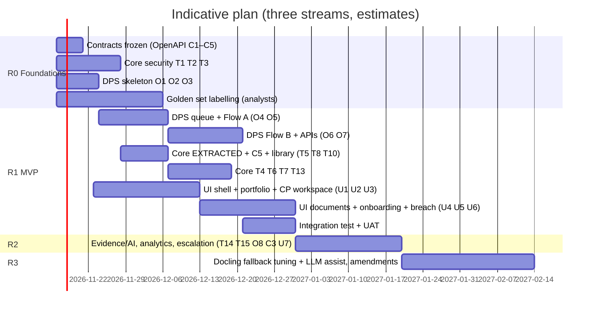

# 06: Implementation Plan

All durations are estimates for one experienced developer per stream. **Decision D12: our team builds all three codebases.** Their Core repo is forked, the DPS gets a new repo, and the new UI gets a new repo (or a `ui/` folder in a monorepo). Changes to the forked Core are offered back to the other team as pull requests.

## 1. Work items: Covenant Core (forked; Java Spring Boot)

| ID | Item | Detail | Est. |
|---|---|---|---|
| T1 | Spring Security resource server | Validate Entra ID JWT; map claims → user + roles; keep `X-User` only as gateway-set value; `CurrentUserContext` reads the authenticated principal | 4–6 d |
| T2 | Portfolio checks everywhere | One `CpAccessGuard` used by review grid, assessments list/get/run, dispositions, attachments, certificates, manual completion, AI suggestions, cycles, applied covenants. Test per endpoint (anonymous, other RM, own RM) | 4–5 d |
| T3 | Remove default support token | Default only in `application-dev.yml`; fail startup when `covenant.support.enabled=true` and token blank | 0.5 d |
| T4 | Extension date ≥ today; maker-checker (configurable, default ON) | Validation in `ReviewService.setDisposition`; disposition states REQUESTED → APPROVED/REJECTED; APPROVER action; only APPROVED counts as handled in `DispositionRules`; admin setting; audit (FR-19) | 4–5 d |
| T5 | `ThresholdSource.EXTRACTED` + `ExtractionRecommender` | Resilient WebClient (timeout/circuit breaker like ML); merge into `OnboardingRecommendationService`; Flyway migration for the enum value; grid source "EXTRACTED" | 3–4 d |
| T6 | Certificates per CP and period | Certificate requirement entity (cpId, period, due date, state); OVERDUE computation; upload links to requirement (FR-22) | 3–4 d |
| T7 | Currency and FX | Reporting-currency setting; dated FX table; conversion service used by APIs that show amounts (FR-23) | 3 d |
| T13 | Period comparison + exports | API for comparing assessments across periods; Excel export of cycle matrix and library (FR-24) | 3 d |
| T14 | Portfolio analytics APIs | Sector/industry risk, exposure, entity mix, trend per covenant (FR-25, FR-26) | 3–4 d |
| T15 | Escalation + management reports | Escalation rules via notification service; breach/compliance report Excel/PDF (FR-31, FR-32) | 4–5 d |
| T8 | `POST /api/v1/data-events` (C5) | `recordSourceChange` + targeted re-assessment; idempotency key; SERVICE role | 2–3 d |
| T9 | Staleness rule for `LATEST` | Optional max-age per measure (e.g. 400 days); older ⇒ missing ⇒ ERROR | 2 d |
| T10 | Library additions | Masters + measures for DPS line items (`DPS_*`), DEBT_TO_NET_WORTH, EBITDA_TO_EMI | 2–3 d |
| T11 | Quartz clustering + prod profile | `isClustered: true`, SQL Server datasource via env, no H2 defaults in prod | 1–2 d |
| T12 | Contract tests | C1/C3 consumer tests against DPS OpenAPI; C2 already covered by `WebClientDataApiClientTest` style | 2–3 d |

## 2. Work items: Document Processing Service (our team)

| ID | Item | Detail | Est. |
|---|---|---|---|
| O1 | New service skeleton | `dps/` package: FastAPI app (sync endpoints or threadpool), settings, logging with correlation id, health | 2 d |
| O2 | Database | SQLAlchemy + Alembic; tables `dps_document`, `dps_job`, `dps_flow_state`, `dps_extracted_term`, `dps_statement`, `dps_statement_value`, `dps_event_outbox`, `dps_audit` | 3 d |
| O3 | Auth | Validate Entra ID JWT; roles; CP access check via Core/CP cache; service token for Core calls | 2–3 d |
| O4 | Job queue + workers | `dps_job` claim loop, timeouts, retries, idempotency; `SqlServerFlowPersistence` implementing `FlowPersistence`; two pools (`dps-worker`, `dps-worker-heavy` for Docling) with routing flag `needs_docling` | 5–6 d |
| O5 | Flow A | Port `LoanAgreementExtractionTool` into steps; `ParserEngine` with pypdf + RapidOCR primary, pdfplumber tables, Docling fallback worker pool; per-page OCR routing; fix regex `\\s*`; typed thresholds with units; citation check; mapper (04 §6.1); publish | 6–8 d |
| O6 | Flow B | Statement parser for tables (multi line-item, multi-period); derived inputs; data-quality checks; versioning; outbox → C5 | 7–10 d |
| O7 | APIs | C1, C2, C3 (optional), document/job/term endpoints, document ↔ CP links (FR-21), manual value entry by approver (FR-20) | 4–5 d |
| O8 | Narrative | Move risk-commentary prompt to Report step (once per job, after Core result); label as advisory | 1–2 d |
| O9 | Tests | pytest unit + API tests; golden-set harness (precision/recall per covenant); contract tests C1/C2 | 5–7 d |
| O10 | Retire old app | Remove `web.py` UI, TinyDB, HITL, reminders, crew; keep a migration script if history needed | 2 d |

**Reused code** (moved, not rewritten): PDF text/OCR, clause splitter, threshold/formula extraction, non-financial rules, source scoring, statement field aliases, risk-commentary prompt.

**Dropped:** `crew.py` agents, `CovenantReportTool` decisions, `human_in_the_loop.py`, `reminders.py`, `intake_db.py`, chat/news (until R3).

## 2b. Work items: New UI (React 18 + TypeScript + Mantine + TanStack, Vite)

| ID | Item | Detail | Est. |
|---|---|---|---|
| U1 | App shell | URL routing, SSO login (MSAL), role-based menus, layout, theming, API clients (reuse their typed `fetch` client), error envelope | 4–5 d |
| U2 | Portfolio | By-CP scorecard, agenda + calendar, health card (reuse their logic), analytics widgets (FR-25) | 6–8 d |
| U3 | CP workspace | Covenants with timing, assessment grid with headroom/trend, assessment detail and history, period compare + Excel (FR-24, FR-26) | 6–8 d |
| U4 | Documents & extraction review | Upload (link to N CPs), job status, PDF viewer with highlight (pdf.js), term edit/approve/reject (FR-01, FR-05, FR-21) | 6–8 d |
| U5 | Onboarding | Lookup, recommendation grid with RECOMMENDED / ML / EXTRACTED rows, source links, per-row configuration, apply (FR-06) | 5–6 d |
| U6 | Breach handling | Disposition request/approve (maker-checker), AI suggestions, evidence and certificates per period, manual value entry (FR-19, FR-20, FR-22) | 5–6 d |
| U7 | Library & admin | Covenants (formula builder reused), measures, data sources, settings incl. currency, support toolkit, document jobs & AI runs | 6–8 d |
| U8 | Tests | Vitest unit (coverage ≥ 90%), Playwright E2E for PRD journeys, accessibility checks (axe) | 5–6 d |

## 3. Phases and dependencies

Critical path: contract freeze → Flow A → Flow B → UI documents/onboarding → integration test. Core security work runs in parallel and must finish before UAT. With three developers (Core, DPS, UI), R1 is about 8–10 weeks (estimate).

## 4. Test strategy

| Level | Core | DPS |
|---|---|---|
| Unit | Existing 964 + new (T2 guard, T4, T5, T8) | Steps of Flow A/B, mapper, unit conversion, data-quality rules, `ParserEngine` routing (when to send to Docling) |
| Parser | — | Each golden-set file through primary and fallback engines; numbers, table cells and page references compared to labels; timing per page |
| Contract | Consumer tests for C1/C3; provider test for C5 | Provider tests for C1/C2/C3; consumer test for C4/C5 |
| Golden set | — | ≥ 20 agreements, ≥ 20 statements; gate: precision ≥ 95%, recall ≥ 85% |
| Integration | Testcontainers SQL Server + DPS stub (already proven with a stub, verification §1.3) | DPS + Core (dev profile) in CI |
| Security | Per-endpoint portfolio tests (anonymous / other RM / own RM); ZAP baseline | Same; upload fuzzing |
| E2E | Playwright: journeys 1–4 from PRD §5 | — |
| Performance | Daily run 10k covenants | Flow A/B p95; C2 p95 |

## 5. Data migration (only if PRD Q6 = yes)
1. Map our 34 companies to CP/obligor ids (manual table with RMs).
2. Import loan agreements as DPS documents; re-run Flow A; RM re-confirms (don't trust old selections blindly).
3. Import past statement values as DPS statement versions with `asOfDate`.
4. Do **not** import old decisions as Core assessments. 9 stored reports have wrong overall status (F-01). If history display is needed, store it as read-only "legacy reports".

## 6. Rollout
1. Dev → SIT with WireMock for external services → UAT with a pilot RM team (5–10 CPs).
2. Pilot runs in parallel with manual entry for 1 cycle; compare extracted vs manual covenants (G2/G6 metrics).
3. Feature flags: `EXTRACTED` recommendations, C5 re-assessment, AI suggestions, narrative. Each can be switched off without redeploying.
4. Go-live gate: R0 security items closed, golden-set gate passed, pen-test findings ≤ medium, runbook signed off.

## 7. Rollback
- DPS down or misbehaving: Core continues (no EXTRACTED rows; DPS-sourced measures ERROR). Disable flags.
- Bad extraction released: proposals are never applied without RM confirmation; revert DPS version; re-run affected jobs.
- Core migrations: forward-only Flyway with tested down-scripts for the new enum/table changes.
